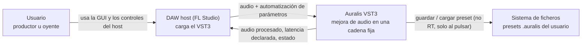
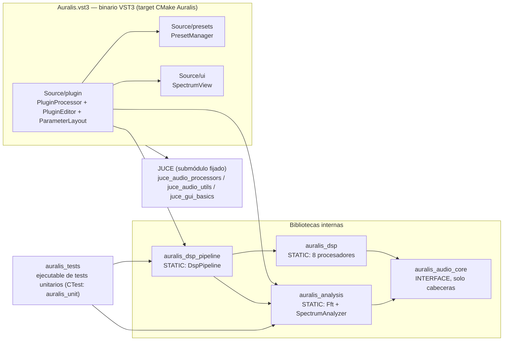
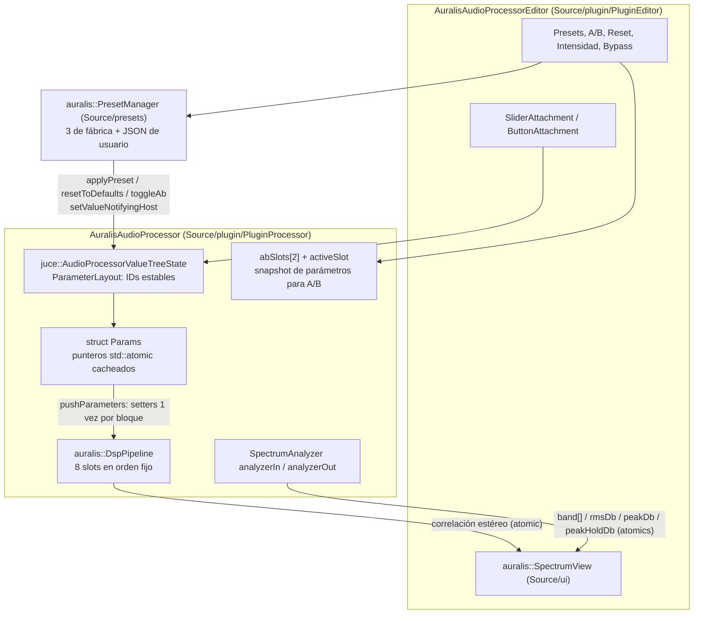
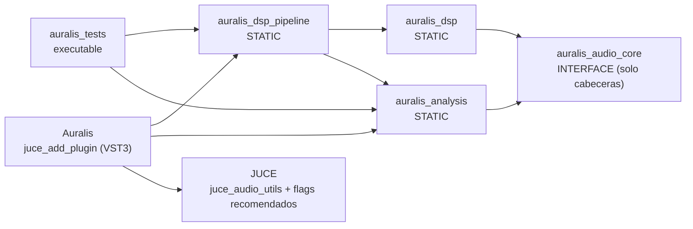
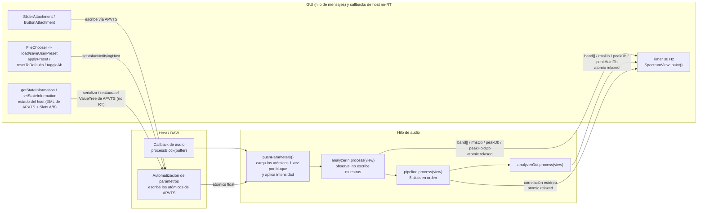

# ARCHITECTURE.md — Arquitectura

> Fuente de verdad: `Plan_Auralis_VST3_Cpp_JUCE_OpenSource.md` (sobre todo §4–§7). Reglas de contribución y límites duros: `AGENTS.md`.
> Este documento describe el **código real en HEAD** (proyecto v0.2.0, slices 0–12 implementados), no el plan en futuro.

## 1. Visión general

Auralis es un plugin VST3 (Windows x64, C++20 + JUCE) que procesa audio en una **cadena fija y modular**. La frontera con el host vive en `Source/plugin` (adapter JUCE: ciclo de vida, buses, parámetros, estado y editor); el motor de audio es propio y vive en `modules/` (`audio_core`, `dsp/<efecto>`, `dsp_pipeline`, `analysis`), compila y se prueba **sin host ni GUI**. Los parámetros se exponen con IDs estables vía APVTS, la cadena se cablea en un único punto (`PluginProcessor::buildPipeline`), el analizador observa la señal en pre y post sin escribir muestras, y los presets de usuario son JSON con `schema_version` separados del estado que guarda el host.

### 1.1 Cadena DSP real

Flujo en `processBlock`:

`Input → Gain → EQ → Bass → Clarity → Dynamics → Ambience → Stereo → Limiter → Output`

| # | Etapa | Clase (`namespace auralis`) | Ruta | Qué hace |
|---|---|---|---|---|
| 1 | Master Gain | `GainProcessor` | `modules/dsp/gain/GainProcessor.{h,cpp}` | Ganancia maestra suavizada (20 ms) y bypass del parámetro `bypass` (expuesto al host como bypass) |
| 2 | EQ | `EqualizerProcessor` | `modules/dsp/equalizer/EqualizerProcessor.{h,cpp}` | 4 bandas RBJ fijas: low shelf, 2 peaking, high shelf; coeficientes recalculados por bloque si hay cambios |
| 3 | Bass | `BassEnhancerProcessor` | `modules/dsp/bass/BassEnhancerProcessor.{h,cpp}` | Low-shelf + highpass de protección de subgraves (opcional) + saturación suave + compensación de nivel |
| 4 | Clarity | `ClarityProcessor` | `modules/dsp/clarity/ClarityProcessor.{h,cpp}` | Excitador armónico paralelo (`tanh` sobre paso alto), con presencia y compensación |
| 5 | Dynamics | `CompressorProcessor` | `modules/dsp/dynamics/CompressorProcessor.{h,cpp}` | Compresor feed-forward estéreo-linkado, detector peak o RMS (~10 ms), knee, makeup; ganancia reducida en atómico |
| 6 | Ambience | `AmbienceProcessor` | `modules/dsp/ambience/AmbienceProcessor.{h,cpp}` | Reverb FDN de 8 líneas con diffusers, predelay, damping, width; expone su decay como cola al host |
| 7 | Stereo | `StereoEnhancerProcessor` | `modules/dsp/stereo/StereoEnhancerProcessor.{h,cpp}` | Mid/Side: width, mid/side gain, balance; publica la correlación estéreo en un atómico |
| 8 | Limiter | `LimiterProcessor` | `modules/dsp/limiter/LimiterProcessor.{h,cpp}` | Limitador con lookahead de 5 ms, release one-pole y ceiling como clamp duro; declara su latencia |

Detalles:

- La etapa **Gain** precede a los ocho efectos del plan (§5.2); el orden se fija en `PluginProcessor::buildPipeline()` y nadie más lo modifica.
- **Intensidad global** (`intensity`): el adapter escala la profundidad de cada efecto (ganancias, cantidades, width) en `pushParameters()`; frecuencias, tiempos y el limitador no se escalan.
- **Analizador**: `SpectrumAnalyzer analyzerIn` y `analyzerOut` se ejecutan en `processBlock` antes y después del pipeline, respectivamente. No son slots del pipeline: son observadores de solo lectura.
- **Latencia y cola**: `prepareToPlay` llama a `setLatencySamples(limiter.getLatencySamples())`; `getTailLengthSeconds()` devuelve el decay de la reverb.
- Algoritmos en detalle: [DSP-ALGORITHMS.md](DSP-ALGORITHMS.md).

## 2. Vistas del sistema (C4 como diagramas `flowchart`)

### 2.1 Nivel 1 — Contexto



### 2.2 Nivel 2 — Contenedores



### 2.3 Nivel 3 — Componentes



- `ParameterLayout` (`Source/plugin/ParameterLayout.cpp`) define todos los parámetros del host; los IDs son API estable (nunca renombrar, solo añadir). Catálogo: [PARAMETERS.md](PARAMETERS.md).
- `PresetManager` no depende de APVTS ni toca audio: solo datos (`Preset`, JSON `schema_version`); el adapter aplica los valores al árbol de parámetros.
- El editor usa attachments de APVTS para la mayoría de controles y llama al adapter para presets, reset y A/B. Nunca llama a setters de procesadores.

## 3. Límites de responsabilidad

Tabla verificada contra los `#include` reales de HEAD (no solo contra `AGENTS.md`):

| Capa / ruta | Puede incluir / hacer | Nunca |
|---|---|---|
| Adapter JUCE — `Source/plugin` | `juce_audio_processors`, `juce_gui_basics`, contratos DSP (`IDspProcessor`, `DspPipeline`, procesadores), `PresetManager`, `SpectrumView`; cablear la cadena y traducir host ↔ dominio | Algoritmos DSP propios; lógica de presets específica; tocar muestras fuera de `processBlock` |
| Presets — `Source/presets` | `juce_core` (String/JSON), datos de preset y validación de `schema_version` | Procesado de audio, APVTS, E/S de ficheros dentro de la lógica de preset (el I/O ocurre en el adapter, en llamadas de host no-RT) |
| GUI — `Source/ui` | `juce_gui_basics`; leer atómicos del analizador y de correlación en `paint` | Escribir/leer buffers de audio; llamar setters de procesadores |
| Contrato — `modules/audio_core` | Solo estándar C++: `IDspProcessor`, `DspTypes` (`AudioBufferView`, `ProcessContext`), `Smoother` | `juce_*`, VST3, GUI, ficheros |
| Procesadores — `modules/dsp/**` | Contrato `audio_core` + estándar (`<cmath>`, `<algorithm>`, `<vector>` en `prepare`) | `juce_*` (verificado: ninguno), ficheros, registro, red, GUI |
| Pipeline — `modules/dsp_pipeline` | `IDspProcessor` y `std`; ejecutar slots en orden | `juce_*` (verificado: solo `IDspProcessor.h` + `std`), lógica del host |
| Análisis — `modules/analysis` | `Fft.h`, `DspTypes.h`, `std`; publicar snapshots en atómicos `relaxed` | `juce_*` (verificado), cualquier cosa que bloquee el hilo de audio |
| Tests — `tests/unit` | Módulos internos y `std` (`iostream`), sin host ni GUI | JUCE, dependencias del adapter |

> **Regla dura (AGENTS.md §2).** `juce_*` solo en `Source/plugin` y `Source/ui`; nunca en `Source/domain`, `Source/parameters`, `Source/state`, `modules/dsp/**`, `modules/dsp_pipeline/**` ni `modules/audio_core/**`. Verificado en HEAD: ningún fichero de `modules/**` incluye cabeceras JUCE; la única excepción fuera de `plugin`/`ui` es `Source/presets/PresetManager.h`, que incluye solo `juce_core` (no es capa DSP ni está vetada por AGENTS.md §2).
>
> En HEAD no existen directorios `Source/domain`, `Source/parameters`, `Source/state` ni `modules/telemetry`: esas responsabilidades del plan §4–§6 viven hoy dentro de `Source/plugin` (`ParameterLayout` y `PluginProcessor`).

## 4. Grafo de dependencias entre targets CMake

Verificado contra `CMakeLists.txt` (`X --> Y` = X enlaza Y):



- `auralis_audio_core` es `INTERFACE` (solo expone `modules/audio_core` como include dir); el resto son `STATIC`.
- `auralis_dsp` expone `modules/dsp`; `auralis_analysis` expone `modules/analysis`; `auralis_dsp_pipeline` expone `modules/dsp_pipeline`.
- El target `Auralis` compila además `Source/plugin`, `Source/presets` y `Source/ui`, y activa `juce_recommended_warning_flags` (cero avisos nuevos) y LTO.
- `auralis_tests` se registra en CTest como `auralis_unit`. No enlaza JUCE: los módulos se prueban headless.

## 5. Modelo de hilos



Reglas y mecanismos reales:

- **Parámetros**: el host escribe los `std::atomic<float>` de APVTS (o el editor mediante attachments / `setValueNotifyingHost`). El hilo de audio lee esos valores una sola vez por bloque en `pushParameters()` a través de punteros cacheados en `cacheParams()` — nunca por nombre ni dentro del bucle de muestras. Los setters de los procesadores solo actualizan objetivos de `Smoother`; nada salta directo a la señal.
- **Analizador → GUI**: única vía de comunicación audio→GUI. El analizador escribe `band[32]`, `rmsDb`, `peakDb` y `peakHoldDb` con `memory_order_relaxed` (y la correlación, igual); el editor repinta a 30 Hz y `SpectrumView::paint` los lee con `relaxed`. Política: snapshot de "última muestra gana", puede ir un frame por detrás; no hay colas SPSC en HEAD. Si un flujo futuro necesita mensajes, se aplicará la política del plan §4.4 (cola SPSC pre-dimensionada y regla de descarte).
- **GUI**: solo hilo de mensajes. No toca buffers ni setters de procesadores; usa APVTS para automatizar igual que el host.
- **Presets y estado**: `saveUserPreset` / `loadUserPreset` hacen E/S de fichero en el hilo de mensajes (nunca en `processBlock`). El estado del host (`getStateInformation` / `setStateInformation`) serializa APVTS + los dos slots A/B; el hook de migración lee `schema_version` (estados sin versión se tratan como 1).
- Flujos detallados paso a paso: [RUNTIME-FLOWS.md](RUNTIME-FLOWS.md).

## 6. Mapa de directorios del repositorio

| Ruta | Contenido y propósito |
|---|---|
| `Source/plugin/` | Adapter JUCE: `PluginProcessor` (buses, `processBlock`, parámetros, estado, A/B), `PluginEditor` (GUI), `ParameterLayout` (IDs estables) |
| `Source/presets/` | `PresetManager`: presets de fábrica y JSON de usuario (`.auralis`, `schema_version`) |
| `Source/ui/` | `SpectrumView`: vista de espectro/medidores de solo lectura |
| `modules/audio_core/` | Contrato interno: `IDspProcessor`, `DspTypes`, `Smoother` (target `auralis_audio_core`) |
| `modules/dsp/<efecto>/` | Un directorio por efecto (gain, equalizer, bass, clarity, dynamics, ambience, stereo, limiter), un par `.h/.cpp` por clase |
| `modules/dsp_pipeline/` | `DspPipeline`: slots ordenados con enable por slot |
| `modules/analysis/` | `Fft` (radix-2 propia) y `SpectrumAnalyzer` (32 bandas log, 20 Hz–20 kHz) |
| `tests/unit/` | Tests unitarios de pipeline y cada efecto; se ejecutan como `auralis_tests` |
| `tools/` | `install.ps1`: copia el VST3 construido a la carpeta que escanea FL Studio |
| `docs/` | Documentación del proyecto (este archivo, `PRODUCT.md`, guías de build/DSP/interfaces, etc.) |
| `.github/workflows/` | `ci.yml`: build, tests, pluginval y empaquetado en Windows |
| `JUCE/` | Submódulo fijado — nunca se modifica ni se commitea dentro de él |
| Raíz | `CMakeLists.txt`, `CMakePresets.json`, `AGENTS.md`, plan, `LICENSE`, `THIRD_PARTY_NOTICES.md`, `README.md`, `CONTRIBUTING.md`, `SECURITY.md`, `CODE_OF_CONDUCT.md` |

## 7. Decisiones de diseño clave

1. **Adapter / dominio separados.** JUCE se confina a `Source/plugin` y `Source/ui` (más `juce_core` en presets); el motor vive en `modules/` y se compila y prueba sin host ni GUI. Razón: si el framework de integración cambia, los procesadores no se reescriben (plan §3.3); verificado: `modules/**` no incluye JUCE y `auralis_tests` no enlaza JUCE.
2. **Cadena fija y modular.** `DspPipeline` ejecuta slots en orden; el orden se cablea en exactamente un sitio (`PluginProcessor::buildPipeline`). Razón: comportamiento predecible, cada efecto se valida por separado; el grafo dinámico está fuera de alcance (PRODUCT.md y plan §5.2).
3. **Contrato `IDspProcessor` (`prepare` / `process` / `reset`).** Uniforme para todos los efectos y con tipos propios (`AudioBufferView` sobre `float*`, `ProcessContext`), no tipos JUCE. `prepare` asigna y configura; `process` solo computa; `reset` limpia estado. Detalles del contrato: [INTERFACES.md](INTERFACES.md).
4. **Reglas de tiempo real estrictas.** En la ruta de audio no hay asignaciones ni locks ni E/S ni logging ni llamadas al message thread (`processBlock` y todo lo que llama). Se apoya en: punteros atómicos cacheados, suavizado de todo valor audible (`Smoother`), `ScopedNoDenormals`, analizadores de solo lectura y `std::atomic`, y latencia declarada (`setLatencySamples`). Cualquier atajo deliberado queda marcado con `// shortcut: ...` y se lista en [SHORTCUTS-DEBT.md](SHORTCUTS-DEBT.md).
5. **Estado y presets separados.** El estado del host es XML de APVTS (+ slots A/B dentro del mismo árbol); los presets son JSON editable con `schema_version`. Razón: el formato de preset evoluciona sin romper el guardado del host y viceversa (plan §5.12).
6. **El análisis no modifica audio.** `SpectrumAnalyzer` copia la suma mono a scratch pre-asignado y publica snapshots atómicos; la GUI solo lee. Razón: medidores y espectro sin bloquear ni alterar la señal (plan §5.10).

## 8. Receta: cómo añadir un nuevo efecto

1. **Crear el directorio y la clase**: `modules/dsp/<nombre>/<Nombre>Processor.h` + `.cpp`, primera línea `// SPDX-License-Identifier: AGPL-3.0-only`, clase `auralis::<Nombre>Processor : public auralis::IDspProcessor`. Implementar `prepare` (asignar/calcular aquí), `process` (sin asignar) y `reset`; añadir setters de control ("call once per block") y `Smoother` para todo valor audible.
2. **CMake**: añadir el `.cpp` a `target_sources(auralis_dsp ...)` en el `CMakeLists.txt` raíz.
3. **Registrar en el pipeline**: crear el procesador en `PluginProcessor::buildPipeline()` con `pipeline.addProcessor(std::make_unique<...>())` y guardar el puntero como miembro. Es el único punto de cableado; no tocar `DspPipeline` si el efecto no lo requiere.
4. **Parámetros**: añadir los IDs en `ParameterLayout.cpp` (nunca renombrar; solo añadir), los campos correspondientes en `struct Params`, leerlos en `cacheParams()` y aplicarlos en `pushParameters()` (si es un control de profundidad, escalarlo por `intensity`; frecuencias/tiempos no se escalan).
5. **Test**: `tests/unit/Test<Nombre>.cpp` con `run_<Nombre>Tests()` que devuelva el número de fallos; declararlo y sumarlo en `TestMain.cpp`, y añadir el fichero a `target_sources(auralis_tests ...)`.
6. **Documentar y declarar dependencias**: actualizar [PARAMETERS.md](PARAMETERS.md) y [DSP-ALGORITHMS.md](DSP-ALGORITHMS.md); cualquier dependencia o asset nuevo necesita su fila en `THIRD_PARTY_NOTICES.md` antes del merge.
7. **Validar**: build release + `ctest` + pluginval (§9). Probar mono y estéreo, tamaños de bloque variables, 44.1/48/88.2/96 kHz y ausencia de NaN/inf. Si el efecto introduce latencia, declararla con `setLatencySamples`; si tiene cola (reverb), exponerla en `getTailLengthSeconds`.

## 9. Validación y CI

Comandos locales (PowerShell, raíz del repo):

```powershell
git submodule update --init --recursive
cmake --preset msvc
cmake --build --preset release
ctest --test-dir build -C Release --output-on-failure
pluginval --strictness-level 8 --validate build/Auralis_artefacts/Release/VST3/Auralis.vst3
```

El VST3 resultante está en `build/Auralis_artefacts/Release/VST3/Auralis.vst3`; `tools/install.ps1` lo copia a la carpeta VST3 del sistema para FL Studio.

CI: `.github/workflows/ci.yml` (runner `windows-latest`) ejecuta configure/build con el preset `ci` (Ninja, `build-ci/`), `ctest`, `pluginval` v1.0.4 a strictness 8, y empaqueta `Auralis-win64.zip` + SHA256 como artefacto. Procedimiento completo y release: [BUILD-TEST-RELEASE.md](BUILD-TEST-RELEASE.md).

## 10. Documentación relacionada

- [PRODUCT.md](PRODUCT.md) — qué es Auralis, alcance y MVP.
- [DSP-ALGORITHMS.md](DSP-ALGORITHMS.md) — algoritmos de cada etapa de la cadena.
- [PARAMETERS.md](PARAMETERS.md) — catálogo de IDs, rangos y defaults.
- [RUNTIME-FLOWS.md](RUNTIME-FLOWS.md) — flujos de audio, parámetros, presets y estado.
- [INTERFACES.md](INTERFACES.md) — contrato `IDspProcessor`, `audio_core` y fronteras entre capas.
- [USER-GUIDE.md](USER-GUIDE.md) — uso del plugin y de la GUI en el DAW.
- [BUILD-TEST-RELEASE.md](BUILD-TEST-RELEASE.md) — build, tests, pluginval, CI y release.
- [SHORTCUTS-DEBT.md](SHORTCUTS-DEBT.md) — atajos deliberados (`// shortcut:`) y cuándo revisarlos.
- [TROUBLESHOOTING.md](TROUBLESHOOTING.md) — problemas comunes de build, carga y audio.
