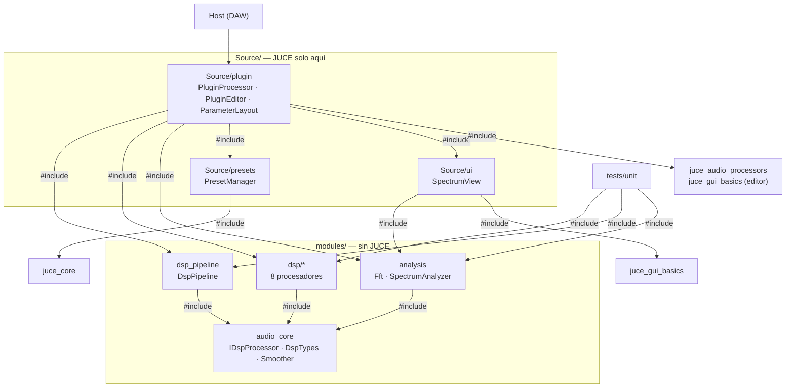
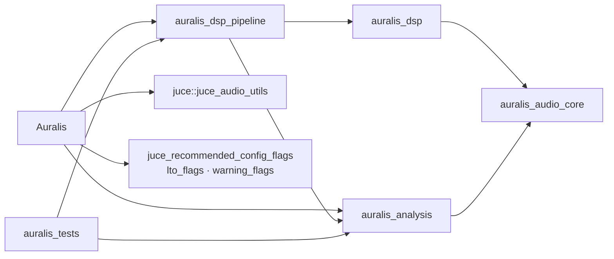

# INTERFACES.md — Referencia de interfaces y clases

> Documenta el código real en HEAD (`3fcee43`, 2026-11-03). Verificado contra los headers, `CMakeLists.txt` y `tests/unit/*`. Para contexto y reglas: [ARCHITECTURE.md](ARCHITECTURE.md), `AGENTS.md` y el `Plan_Auralis_VST3_Cpp_JUCE_OpenSource.md`. Documentos relacionados: [DSP-ALGORITHMS.md](DSP-ALGORITHMS.md), [PARAMETERS.md](PARAMETERS.md), [RUNTIME-FLOWS.md](RUNTIME-FLOWS.md), [BUILD-TEST-RELEASE.md](BUILD-TEST-RELEASE.md), [SHORTCUTS-DEBT.md](SHORTCUTS-DEBT.md), [PRODUCT.md](PRODUCT.md).

Este documento es de nivel desarrollador/mantenedor: firmas exactas, estado interno, invariantes y puntos de extensión. No repite algoritmos (eso es [DSP-ALGORITHMS.md](DSP-ALGORITHMS.md)) ni el catálogo de parámetros ([PARAMETERS.md](PARAMETERS.md)).

Estado real de HEAD: los slices 0–12 están implementados. No existen todavía `Source/domain`, `Source/parameters`, `Source/state` ni `modules/telemetry` (aparecen en el mapa del plan, no en el código). La lógica de dominio/estado vive hoy en `Source/plugin` y `Source/presets`.

---

## 1. Inventario de archivos (sin `JUCE/` ni `build*/`)

Targets CMake (`CMakeLists.txt`): `Auralis` (plugin VST3), `auralis_audio_core` (INTERFACE), `auralis_dsp` (STATIC), `auralis_analysis` (STATIC), `auralis_dsp_pipeline` (STATIC), `auralis_tests` (ejecutable + `add_test auralis_unit`). Proyecto versión `0.2.0`, C++20.

### Raíz y configuración

| Ruta | Propósito | ~Líneas | Target |
|---|---|---|---|
| `CMakeLists.txt` | Targets, fuentes, definiciones y linkado del plugin, DSP, análisis, pipeline y tests | 93 | — |
| `CMakePresets.json` | Presets `msvc`/`release`/`ci` usados por build y CI | 29 | — |
| `.github/workflows/ci.yml` | CI Windows: configure, build, ctest, pluginval nivel 8, empaquetado ZIP + SHA256 | 46 | CI |
| `tools/install.ps1` | Copia el VST3 construido a la carpeta de plugins del usuario | 14 | — |
| `AGENTS.md` | Reglas obligatorias para agentes/contribuidores | 155 | — |
| `README.md`, `CONTRIBUTING.md`, `SECURITY.md`, `CODE_OF_CONDUCT.md`, `LICENSE`, `THIRD_PARTY_NOTICES.md` | Documentación de proyecto y licencias | — | — |
| `Plan_Auralis_VST3_Cpp_JUCE_OpenSource.md` | Fuente de verdad de arquitectura, slices y alcance | — | — |

### `modules/audio_core/` — contrato DSP (sin JUCE)

| Ruta | Propósito | ~Líneas | Target |
|---|---|---|---|
| `IDspProcessor.h` | Interfaz `auralis::IDspProcessor` (prepare/process/reset) | 16 | `auralis_audio_core` |
| `DspTypes.h` | `ProcessContext` y `AudioBufferView` (vista de canales `float*`) | 25 | `auralis_audio_core` |
| `Smoother.h` | Suavizador one-pole header-only para valores de control | 29 | `auralis_audio_core` |

### `modules/dsp/<efecto>/` — procesadores (sin JUCE)

| Ruta | Propósito | ~Líneas | Target |
|---|---|---|---|
| `gain/GainProcessor.h/.cpp` | Ganancia maestra suavizada + bypass del plugin | 25/42 | `auralis_dsp` |
| `equalizer/EqualizerProcessor.h/.cpp` | EQ de 4 bandas fijas RBJ (low shelf, 2 peaking, high shelf) | 48/143 | `auralis_dsp` |
| `bass/BassEnhancerProcessor.h/.cpp` | Low shelf + sub-highpass + saturación suave + compensación | 54/178 | `auralis_dsp` |
| `clarity/ClarityProcessor.h/.cpp` | Excitador armónico paralelo (highpass + soft clip + presencia) | 37/95 | `auralis_dsp` |
| `dynamics/CompressorProcessor.h/.cpp` | Compresor feed-forward estéreo-linkeado, peak o RMS, soft knee | 51/118 | `auralis_dsp` |
| `ambience/AmbienceProcessor.h/.cpp` | Reverb FDN de 8 líneas con difusores, predelay, damping y width | 57/179 | `auralis_dsp` |
| `stereo/StereoEnhancerProcessor.h/.cpp` | M/S: width, gains mid/side, balance y medidor de correlación | 37/89 | `auralis_dsp` |
| `limiter/LimiterProcessor.h/.cpp` | Limitador peak con lookahead 5 ms, release one-pole, ceiling | 49/111 | `auralis_dsp` |

### `modules/dsp_pipeline/` y `modules/analysis/` (sin JUCE)

| Ruta | Propósito | ~Líneas | Target |
|---|---|---|---|
| `dsp_pipeline/DspPipeline.h/.cpp` | Contenedor ordenado de `IDspProcessor` con enable/disable atómico | 37/39 | `auralis_dsp_pipeline` |
| `analysis/Fft.h/.cpp` | FFT radix-2 iterativa, tablas en constructor, `transform()` sin asignar | 26/85 | `auralis_analysis` |
| `analysis/SpectrumAnalyzer.h/.cpp` | Observador de audio: RMS/peak/peak-hold + espectro de 32 bandas log en atómicos | 41/125 | `auralis_analysis` |

### `Source/` — capa plugin (JUCE)

| Ruta | Propósito | ~Líneas | Target |
|---|---|---|---|
| `plugin/PluginProcessor.h/.cpp` | Adaptador JUCE: APVTS, pipeline, A/B, estado, presets, analizadores in/out | 136/309 | `Auralis` |
| `plugin/PluginEditor.h/.cpp` | Editor: top bar (presets, A/B, intensity, bypass), spectrum, grid de parámetros | 56/167 | `Auralis` |
| `plugin/ParameterLayout.h/.cpp` | `createAuralisParameterLayout()`: 49 parámetros con IDs estables | 8/88 | `Auralis` |
| `presets/PresetManager.h/.cpp` | Presets JSON (`schema_version`, `name`, `params`) + 3 presets de fábrica | 30/60 | `Auralis` |
| `ui/SpectrumView.h/.cpp` | Componente que dibuja el espectro y los medidores leyendo atómicos | 29/71 | `Auralis` |

### `tests/unit/` — tests de host

| Ruta | Propósito | ~Líneas | Target |
|---|---|---|---|
| `TestMain.cpp` | `main()`: helpers `CHECK`/`TestBuffer`, tests del pipeline y llamadas a `run_*Tests()` | 247 | `auralis_tests` |
| `TestEqualizer.cpp`, `TestBass.cpp`, `TestClarity.cpp`, `TestDynamics.cpp`, `TestAmbience.cpp`, `TestStereo.cpp`, `TestLimiter.cpp` | Un archivo por procesador; exponen `int run_<Nombre>Tests()` | 187–274 | `auralis_tests` |
| `TestFft.cpp`, `TestAnalyzer.cpp` | FFT y analyzer (incluye comprobación de que el buffer no se modifica) | 91/172 | `auralis_tests` |

### `docs/`

| Ruta | Propósito | ~Líneas |
|---|---|---|
| `ARCHITECTURE.md`, `PRODUCT.md` | Arquitectura, límites de capa y definición de producto | 64/33 |
| `INTERFACES.md` | Este documento | — |

---

## 2. Grafo real de inclusiones y dependencias

### 2.1 `#include` entre capas (verificado)



Detalle de cada capa:

| Capa | Incluye (real) | Nunca incluye |
|---|---|---|
| `modules/audio_core` | `DspTypes.h` ← `IDspProcessor.h`; `<cmath>` en `Smoother.h` | JUCE, E/S, host |
| `modules/dsp/**` | `IDspProcessor.h`, `Smoother.h`; std: `<algorithm> <array> <atomic> <cmath> <cstddef> <vector>` | `juce_*`, ficheros, registry, red |
| `modules/dsp_pipeline` | `IDspProcessor.h`; std: `<atomic> <cstddef> <memory> <vector>` | `juce_*`, lógica de host |
| `modules/analysis` | `Fft.h`, `DspTypes.h`; std: `<atomic> <cmath> <vector>` | `juce_*`, bloqueo del hilo de audio |
| `Source/presets` | `juce_core`; std: `<map> <vector>` | `juce_audio_processors`, audio, UI |
| `Source/ui` | `juce_gui_basics`, `SpectrumAnalyzer.h` | manipular buffers de audio |
| `Source/plugin` | `juce_audio_processors`, `juce_gui_basics` (editor), `DspPipeline.h`, headers de los 8 procesadores, `SpectrumAnalyzer.h`, `PresetManager.h`, `SpectrumView.h` | algoritmos DSP inline, lógica de presets propia |
| `tests/unit` | headers DSP + `DspPipeline.h` + `Fft.h` + `SpectrumAnalyzer.h`; `<iostream>` | JUCE, GUI, host |

Nota: `PluginProcessor.cpp` incluye además `ParameterLayout.h` y `PluginEditor.h` (implementación de `createEditor`); `PluginProcessor.h` solo declara `class AuralisAudioProcessorEditor;` (forward) y `PluginEditor.h` incluye `PluginProcessor.h`.

### 2.2 Targets CMake



- `auralis_dsp_pipeline` linka `auralis_dsp` y `auralis_analysis` como `PUBLIC`: quien linka el pipeline obtiene los include dirs `modules/dsp` y `modules/analysis` (así `PluginProcessor.h` y los tests incluyen `gain/GainProcessor.h`, `SpectrumAnalyzer.h`, etc.).
- Definiciones del plugin: `JUCE_WEB_BROWSER=0`, `JUCE_USE_CURL=0`, `JUCE_VST3_CAN_REPLACE_VST2=0`.
- Los tests no usan JUCE: compilan solo contra los targets internos.

---

## 3. Contrato de procesador: `IDspProcessor` y `DspTypes`

`modules/audio_core/IDspProcessor.h`:

```cpp
namespace auralis
{
class IDspProcessor
{
public:
    virtual ~IDspProcessor() = default;
    virtual void prepare (const ProcessContext& ctx) = 0;
    virtual void process (AudioBufferView& buffer) = 0;
    virtual void reset() = 0;
};
}
```

`modules/audio_core/DspTypes.h` (todos los tipos; no hay enums ni más structs):

```cpp
struct ProcessContext
{
    double sampleRate = 48000.0;
    int maxBlockSize = 512;
};

class AudioBufferView
{
public:
    AudioBufferView (float* const* channels, int numChannels, int numFrames);
    int numChannels() const;      // nch
    int numFrames() const;        // nf
    float* channel (int c) const; // chans[c], puntero no const: process escribe in-place
private:
    float* const* chans;
    int nch;
    int nf;
};
```

### Semántica e invariantes

| Método | Cuándo se llama | Qué debe hacer | Qué NO debe hacer |
|---|---|---|---|
| `prepare(ctx)` | `prepareToPlay` (hilo de mensaje) y en tests antes de procesar | Guardar sample rate, redimensionar buffers/retardos, pre-calcular coeficientes y suavizadores. Puede asignar memoria | Procesar audio |
| `process(buffer)` | Una vez por bloque desde el hilo de audio | Transformar los samples in-place (`buffer.channel(c)[i]`), leer parámetros ya fijados vía setters | Asignar, bloquear, loggear, E/S, llamar al message thread |
| `reset()` | Al limpiar estado (p. ej. al recargar proyecto) | Dejar el procesador como recién preparado (ceros, envolventes a reposo) | Cambiar configuración de sample rate/bloque |

Precondiciones comunes:

- `sampleRate > 0` (el plugin pasa el valor del host). Criterio del proyecto: 44.1/48/88.2/96 kHz; los tests cubren 44.1, 48 y 96 kHz.
- Canales: 1 (mono) o 2 (estéreo); los procesadores limitan internamente su estado a 2 canales (`maxChannels = 2`, `kMaxChannels = 2`) y varios ignoran canales extra.
- `numFrames` puede variar por bloque (el test `variableBlockSizes` usa 1, 7, 33, 64, 1024). No hay requisito de múltiplos ni de tamaño fijo; el límite superior práctico es `ctx.maxBlockSize` del host.
- `maxBlockSize` viaja en `ProcessContext` pero **ningún procesador actual lo usa**: el tamaño real de cada bloque es `buffer.numFrames()`; `SpectrumAnalyzer::prepare` lo ignora (argumento sin nombre).
- `process` presupone `prepare` previo (excepciones defensivas: `AmbienceProcessor` sale si no hay buffers, `LimiterProcessor` si `latency <= 0`).
- Orden de llamadas en el pipeline: `prepare` antes de `process`; `reset` en cualquier momento antes o después; los setters de control se llaman una vez por bloque y son `noexcept`/sin asignación.
- Todos los setters devuelven `void`, son `noexcept` y **hacen clamp** salvo `StereoEnhancerProcessor` (confía en el rango del parámetro del host) y `GainProcessor` (acepta cualquier dB).

---

## 4. Referencia de los procesadores DSP

Patrón común: el estado interno solo se toca desde el hilo de audio; los medidores que lee la GUI se publican con `std::atomic<float>` y orden `relaxed`. Los coeficientes trigonométricos se recalculan en setters/prepare (control-rate), nunca dentro de bucles por muestra salvo donde se indique.

### 4.1 `GainProcessor` — ganancia maestra + bypass del plugin

Responsabilidad única: aplicar ganancia suavizada en dB; bypass deja el buffer intacto (passthrough exacto).

```cpp
void prepare (const ProcessContext& ctx) override;
void process (AudioBufferView& buffer) override;
void reset() override;
void setGainDb (float db) noexcept;  // target = 10^(db/20)
void setBypass (bool b) noexcept;

// estado
float coeff = 0.0f;   // one-pole 20 ms: 1 - exp(-1/(0.02*sr))
float current = 1.0f;
float target = 1.0f;
bool bypass = false;
```

- Invariantes: `prepare` fija `current = target` (sin salto de zipper); `process` con `bypass == true` retorna sin escribir.
- RT: suavizado por muestra dentro del bucle; bypass es un branch temprano. Sin atómicos (solo lo toca el hilo de audio).
- Tests: `TestMain.cpp` (`unityGainIsPassthrough`, `gain6dBIncreasesAmplitude`, `bypassIsPassthrough`, `smoothingIsContinuous`).

### 4.2 `EqualizerProcessor` — EQ de 4 bandas RBJ

Responsabilidad única: cadena serie de 4 biquads direct-form I (low shelf, peaking, peaking, high shelf) con coeficientes recalculados en lazy cuando `dirty`.

```cpp
void setBand (int index, float freqHz, float gainDb, float q) noexcept; // clamps: 20–20000 Hz, ±24 dB, Q 0.1–20
void setBandEnabled (int index, bool enabled) noexcept;

static constexpr int maxBands = 4;
static constexpr int maxChannels = 2;

struct Band
{
    float freq, gainDb, q;
    bool enabled = true, dirty = true;
    double b0, b1, b2, a1, a2;          // RBJ normalizados (a0 = 1)
    float x1[maxChannels], x2[maxChannels];
    float y1[maxChannels], y2[maxChannels];
};
Band bands[maxBands];
double sampleRate;
```

- Bandas fijas: `0` = low shelf, `1`/`2` = peaking (usan `q` del parámetro), `3` = high shelf. Las shelves usan un Q fijo (constante `kSqrtTwo` en `updateBand`) e ignoran el Q del setter.
- Invariantes: `index` fuera de rango se ignora (no hay error); el recálculo ocurre dentro de `process` en el primer sample con `dirty`; `reset` limpia estados y no los coeficientes.
- RT: dobles para coeficientes y estado (estabilidad); el coste por bloque es como máximo 4 recálculos. `shortcut:` sin interpolación de coeficientes — zipper leve al automatizar (ver [SHORTCUTS-DEBT.md](SHORTCUTS-DEBT.md)).
- Tests: `TestEqualizer.cpp` (`flatIsPassthrough`, `lowShelfBoostsBass`, `highShelfBoostsTreble`, `peakingBandShapesOnlyCenter`, `disabledBandIsSkipped`, `stabilityAndNoNaN`).

### 4.3 `BassEnhancerProcessor` — graves

Responsabilidad única: sub-highpass opcional → low shelf → saturación suave → compensación de nivel.

```cpp
void setShelfFreq (float freqHz) noexcept;        // clamp 40–200 Hz; recalcula shelf ya
void setShelfGainDb (float gainDb) noexcept;      // clamp ±12 dB; recalcula shelf ya
void setSaturation (float amount01) noexcept;     // clamp 0..1, suavizado 20 ms
void setSubHighpassFreq (float freqHz) noexcept;  // <= 0 => off; si no, clamp 10–60 Hz

struct Biquad { double b0,b1,b2,a1,a2; float x1[2],x2[2],y1[2],y2[2]; };
Biquad shelf, subHp;
Smoother shelfB0Smoother, shelfB1Smoother, shelfB2Smoother, shelfA1Smoother, shelfA2Smoother; // 20 ms
Smoother satSmoother;   // 20 ms
float shelfGainDb, shelfFreq, subHpFreq;
double sampleRate;
```

- Invariantes: los coeficientes de la shelf se suavizan por muestra (fracción por muestra, interpolación de los 5 coeficientes); el sub-highpass no se suaviza y se aplica solo si `subHpFreq > 0`; la saturación usa `tanh(k·x)/tanh(k)` con `k = 1 + 9·sat` y mezcla dry/wet con `sat`.
- RT: `setShelfFreq`/`setShelfGainDb` ejecutan el recálculo RBJ (pow/cos/sin/sqrt) aunque se llamen cada bloque desde `pushParameters` — coste acotado de control-rate, sin asignación. Sub-protección: dos biquads RBJ en cascada, 24 dB/oct (−6 dB en el corte).
- Tests: `TestBass.cpp` (`defaultsArePassthrough`, `subProtectionAttenuatesSubs`, `shelfBoostsBassOnly`, `saturationBoundedAndHarmonic`, `compensationReducesLevel`, `noNaNAndStable`).

### 4.4 `ClarityProcessor` — excitador armónico paralelo

Responsabilidad única: `out = comp · (dry + amount · presence · softClip(highpass(dry)))` con highpass RBJ.

```cpp
void setAmount (float amount01) noexcept;    // clamp 0..1, suavizado 30 ms
void setCenterFreq (float freqHz) noexcept;  // clamp 1000..8000 Hz, recalcula coeficientes ya
void setPresenceDb (float db) noexcept;      // clamp ±6 dB -> lineal, suavizado 20 ms

Smoother amount;    // drive 0..1
Smoother presence;  // ganancia lineal
double centerFreq, sampleRate;
double b0,b1,b2,a1,a2;            // RBJ highpass, direct form I
double x1[2],x2[2],y1[2],y2[2];
```

- Invariantes: con `amount == 0` el sample no se toca (dry exacto, rama del excitador saltada); estado en `double`; `reset` limpia filtro y hace `snap()` de los suavizadores.
- RT: dos `next()` por muestra; `tanh` por muestra en la rama activa. `shortcut:` solo los 2 primeros canales se excitan.
- Tests: `TestClarity.cpp` (`zeroAmountIsExactPassthrough`, `exciterAddsHighs`, `negativePresenceAttenuatesHighs`, `compensationKeepsLevelBounded`, `noNaNLoud`).

### 4.5 `CompressorProcessor` — dinámica

Responsabilidad única: compresor feed-forward estéreo-linkeado (una ganancia compartida por bloque, detectada en el canal más fuerte), detector peak o RMS (~10 ms), soft knee cuadrática.

```cpp
void setThresholdDb (float db) noexcept; // clamp -60..0, suavizado 10 ms en dominio dB
void setRatio (float ratio) noexcept;    // clamp 1..20 -> slope = 1/ratio - 1
void setAttackMs (float ms) noexcept;    // clamp 1..100, recalcula coeficiente
void setReleaseMs (float ms) noexcept;   // clamp 10..1000, recalcula coeficiente
void setKneeDb (float db) noexcept;      // clamp 0..24 -> knee/halfKnee
void setMakeupDb (float db) noexcept;    // clamp 0..24, suavizado 20 ms en dominio dB
void setRmsMode (bool useRms) noexcept;
float getGainReductionDb() const noexcept; // >= 0, actualizado una vez por bloque (relaxed)

Smoother thresholdSmoother, makeupSmoother;
float sampleRate, slope, knee, halfKnee, attackMs, releaseMs;
float coeffAttack, coeffRelease, detCoeff;
float gainDb;        // ganancia suavizada aplicada, incluye makeup
float detectorSq;    // estado one-pole de x² (modo RMS)
bool rmsMode;
std::atomic<float> grDb;
```

- Invariantes: `slope <= 0`, por construcción la atenuación no puede amplificar; `gainDb` combina atenuación + makeup y es el valor que multiplica la señal; `grDb` = reducción media del bloque excluyendo makeup (positivo = reducción); `nf == 0` no actualiza `grDb`.
- RT: por muestra hay `fabs/max` de canales, `log10` y `pow` (no hay path barato); en RMS además `sqrt`. No reparte canales: usa todos los `buffer.numChannels()` (los parámetros del plugin usan mono/stereo).
- Tests: `TestDynamics.cpp` (`transparentAtDefaults`, `staticCurveMatchesMath`, `grMeterReportsReduction`, `makeupAppliesCleanly`, `belowThresholdNoReduction`, `releaseRecoversToUnity`, `noNaNWithExtremeSettings`, `rmsModeReducesGain`).

### 4.6 `AmbienceProcessor` — reverb FDN

Responsabilidad única: reverb de 8 líneas de retardo con realimentación Householder, difusores de 1 muestra, predelay, damping one-pole, buses wet L/R con width y mezcla dry/wet.

```cpp
void setMix (float mix01) noexcept;            // 0..1, suavizado 30 ms
void setPredelayMs (float ms) noexcept;        // 0..200 ms
void setDecaySeconds (float seconds) noexcept; // 0.1..10 (t60)
void setDamping (float damping01) noexcept;    // 0..1 -> fc 18 kHz..1.8 kHz
void setWidth (float width01) noexcept;        // 0..1 (0 = mono)
float getDecaySeconds() const noexcept;        // tail para el host

static constexpr int numLines = 8;
static constexpr int baseLength[8] = { 1543, 2011, 2663, 3413, 4127, 5003, 5741, 6719 };
std::vector<float> line[8];  int lineLength[8], linePos[8];
float dampState[8], gain[8]; // gain derivado de decay por bloque
std::vector<float> predelay; int predelayPos, predelaySamples;
float ap1X, ap1Y, ap2X, ap2Y; // difusores allpass de 1 muestra
Smoother mixSmoother;
float decaySeconds, damping, width, predelayMs;
double sampleRate;
```

- Invariantes: `prepare` es el único punto de asignación (líneas escaladas por `sr/48000`, longitudes impares ≥ 2; predelay de 200 ms + 1); `process` sin preparar es passthrough; con `mix < 1e-4` la salida es dry exacto pero la red sigue corriendo para mantener la cola cálida; en mono el wet se pliega a mid y width cancela.
- RT: recomputa por bloque los 8 `pow` de ganancia t60 + `exp` del damping; por muestra actualiza la red (`H = I - J/4`) y el suavizador de mix. Estado de todos los retardos en `std::vector` preparado.
- Tests: `TestAmbience.cpp` (`zeroMixIsExactPassthrough`, `wetTailExistsAndDecays`, `decaySecondsControlsTail`, `dampingDarkens`, `predelayOffsetsWet`, `stabilityNoNaN`).

### 4.7 `StereoEnhancerProcessor` — imagen estéreo

Responsabilidad única: decodificar M/S, aplicar width, gains mid/side y balance, y publicar la correlación del bloque.

```cpp
void setWidth (float w) noexcept;        // 0..2, 1 = normal (sin clamp interno)
void setMidGainDb (float db) noexcept;   // ±12 dB, suavizado 20 ms
void setSideGainDb (float db) noexcept;  // ±12 dB, suavizado 20 ms
void setBalance (float b) noexcept;      // -1..+1, suavizado 20 ms; b<0 atenúa L con (1+b)
float getCorrelation() const noexcept;                 // -1..+1 (relaxed)
const std::atomic<float>& getCorrelationAtomic() const noexcept; // para la GUI

Smoother widthSmoother, midGainSmoother, sideGainSmoother; // 20 ms
float balance;
std::atomic<float> correlation { 1.0f };
```

- Invariantes: en mono (`nch < 2`) es passthrough exacto y la correlación queda en 1.0; `balance` no está suavizado (documentado en el header); con los defaults la identidad es exacta hasta redondeo float (~1e-7); correlación con epsilon `+1e-12` en el denominador (sin NaN con silencio).
- RT: tres `next()` por muestra + acumuladores `sumLR/sumLL/sumRR`; una publicación atómica por bloque.
- Tests: `TestStereo.cpp` (`identityAtDefaults`, `zeroWidthIsMonoCompatible`, `sideGainShapesImage`, `midGainShapesCenter`, `balanceShiftsChannels`, `correlationValues`, `monoInputPassthrough`, `noNaN`).

### 4.8 `LimiterProcessor` — limitador de salida

Responsabilidad única: limitador peak con lookahead fijo de 5 ms (una delay line por canal, ganancia compartida), ataque instantáneo, release one-pole y ceiling como clamp de seguridad.

```cpp
LimiterProcessor() noexcept;             // threshold target 1.0 hasta que se configure
void setThresholdDb (float db) noexcept; // clamp -24..0, suavizado 5 ms (lineal)
void setCeilingDb (float db) noexcept;   // clamp -12..0, clamp duro de salida
void setReleaseMs (float ms) noexcept;   // clamp 5..1000
int getLatencySamples() const noexcept;  // lookahead L = round(0.005 * sr)
float getGainReductionDb() const noexcept; // >= 0 en dB, por bloque (relaxed)

static constexpr int kMaxChannels = 2;
std::vector<float> delay[2]; // ring por canal, tamaño == latency
Smoother thresholdSmoother;
float sampleRate, releaseMs, ceilingLin, gain;
int latency, writePos;       // writePos == muestra más antigua del ring
std::atomic<float> gainReductionDb;
```

- Invariantes: `process` antes de `prepare` es passthrough (`latency <= 0`); procesa hasta el número de canales preparado (`ProcessContext::numChannels`), los extra pasan sin tocar; el pico de ventana (últimas L entradas + muestra entrante) se calcula con un máximo deslizante exacto (cola monótona, O(1) amortizado), de modo que un pico mantiene la ganancia baja hasta salir de la delay line; la atenuación es instantánea (`targetGain < gain`) y la recuperación un one-pole; el ceiling solo actúa si el threshold no bastó.
- RT: asignación solo en `prepare`; `releaseCoeff` se recalcula una vez por bloque.
- Latencia: el plugin la declara en `prepareToPlay` con `setLatencySamples(limiterProcessor->getLatencySamples())`.
- Tests: `TestLimiter.cpp` (`peakNeverExceedsCeiling`, `gainReductionReported`, `noReductionBelowThreshold`, `releaseControlsRecovery`, `noNaN`).

---

## 5. `DspPipeline`

`modules/dsp_pipeline/DspPipeline.h` — contenedor ordenado; no conoce JUCE.

```cpp
class DspPipeline
{
public:
    struct Slot
    {
        std::unique_ptr<IDspProcessor> proc;
        std::atomic<bool> enabled { true };
        Slot() = default;
        explicit Slot (std::unique_ptr<IDspProcessor> p) noexcept;
        Slot (Slot&& o) noexcept; // mueve proc y copia enabled
    };

    IDspProcessor* addProcessor (std::unique_ptr<IDspProcessor> p); // setup-only
    void prepare (const ProcessContext& ctx);
    void process (AudioBufferView& buffer);
    void reset();
    void setEnabled (std::size_t index, bool enabled) noexcept;     // bounds-checked
    std::size_t size() const noexcept;

private:
    std::vector<Slot> slots; // never resized once prepare was called
};
```

Semántica:

- `addProcessor` hace `push_back` y devuelve el puntero crudo propiedad del slot. **Precondición**: llamarlo solo antes de que corra el hilo de audio (el vector puede reallocar; los punteros no son estables entre altas).
- `prepare` prepara **todos** los slots, también los deshabilitados (re-enable instantáneo sin re-preparar).
- `process` recorre en orden de inserción y salta los `enabled == false` (`load()` relaxed). Cada procesador decide cómo trata canales/mono.
- `setEnabled` con índice fuera de rango es no-op.
- El pipeline no verifica el tamaño del buffer ni el número de canales; el contrato de cada procesador aplica.

Composición real (única posición de cableado: `AuralisAudioProcessor::buildPipeline`, `Source/plugin/PluginProcessor.cpp`), orden fijo del plan §5.2:

```
Gain → EQ → Bass → Clarity → Dynamics → Ambience → Stereo → Limiter
```

Los punteros a cada etapa se guardan como miembros (`gainProcessor`, `eqProcessor`, …) para configurarlos desde `pushParameters`. Nunca se añade DSP inline en `PluginProcessor` ni dentro de otro efecto.

Tests del pipeline en `TestMain.cpp`: pipeline vacío pasa, unidad/6 dB, bypass, slot deshabilitado, tamaños de bloque variables, suavizado continuo, sin NaN con señal alternante y pipeline mono.

---

## 6. `Smoother` (`modules/audio_core/Smoother.h`)

Header-only, one-pole de primer orden, sin asignación ni estado dinámico.

```cpp
class Smoother
{
public:
    void prepare (double sampleRate, float timeMs) noexcept; // coeff y current = target
    void setTarget (float t) noexcept;
    void snap() noexcept;                 // current = target
    float next() noexcept;                // current += coeff * (target - current)
    float value() const noexcept;         // current
private:
    float coeff = 1.0f, current = 0.0f, target = 0.0f;
};
```

Matemática: `coeff = 1 - exp(-1000 / (timeMs * sampleRate))` con `timeMs` en milisegundos. Es un filtro de primer orden cuya constante de tiempo es `timeMs` (en ese tiempo el valor recorre ~63 % de la distancia al target: `1 - e^-1`). `prepare` fija `coeff` y hace `current = target` (sin zipper al recargar). Es la implementación compartida de suavizado; `GainProcessor` usa internamente la misma fórmula con 20 ms fijos por ser más antiguo que el header.

Usuarios: Bass (coeficientes shelf ×5 + saturación, 20 ms), Clarity (amount 30 ms, presence 20 ms), Compressor (threshold 10 ms, makeup 20 ms), Ambience (mix 30 ms), Stereo (width/mid/side 20 ms), Limiter (threshold 5 ms).

---

## 7. Analysis

### 7.1 `Fft` (`modules/analysis/Fft.h/.cpp`)

```cpp
class Fft
{
public:
    explicit Fft (int size); // solo potencia de 2; si no, n = 0 y transform() es no-op
    void transform (float* re, float* im) const noexcept; // in-place, sin asignar
    int size() const noexcept;
private:
    int n;                       // 0 marca tamaño inválido
    std::vector<int> rev;        // bit-reversal
    std::vector<float> cosTable; // cos(2πk/n), k < n/2
    std::vector<float> sinTable; // sin(2πk/n), k < n/2
};
```

- Radix-2 iterativa Cooley-Tukey, convención `exp(-2πi·k/N)` (forward).
- Las tablas se construyen en el constructor (única asignación); `transform` es allocation-free y `const`.
- Tamaño inválido no lanza: degrada a no-op.
- Tests: `TestFft.cpp` (`sinePeakInRightBin`, `dcAndNyquist`, `linearity`).

### 7.2 `SpectrumAnalyzer` (`modules/analysis/SpectrumAnalyzer.h/.cpp`)

Observador de solo lectura del buffer; nunca lo modifica ni asigna en `process`.

```cpp
class SpectrumAnalyzer
{
public:
    static constexpr int numBands = 32;

    void prepare (double sampleRate, int maxBlockSize); // maxBlockSize ignorado hoy
    void process (const AudioBufferView& buffer);       // solo observa
    void reset();

    std::atomic<float> band[numBands] {};  // magnitud 0..1 por banda log
    std::atomic<float> rmsDb { -100.0f };
    std::atomic<float> peakDb { -100.0f };
    std::atomic<float> peakHoldDb { -100.0f };

private:
    void analyze (const AudioBufferView& buffer);
    Fft fft { 1024 };
    std::vector<float> window;   // Hann, 1024
    std::vector<float> re, im;   // scratch FFT, 1024
    int bandEdges[numBands + 1] {}; // bordes log 20 Hz..20 kHz
    float bandNorm = 1.0f;
    int blockCounter = 0;
    float peakHold = 0.0f;
};
```

- Tamaños: FFT fija de 1024; 32 bandas con 33 bordes log-espaciados `20 · 1000^(j/32)` (20 Hz → 20 kHz) mapeados a bins y clampados a `[0, n/2]`; `bandNorm = 4/n` para que una senoide a full scale marque ~1.0.
- `process`: suma mono (media de los 2 primeros canales, o el único) y publica RMS/pico/peak-hold en cada bloque; peak-hold decae `0.005` por bloque; la FFT se ejecuta en uno de cada dos bloques (`blockCounter & 1`). Valores no positivos (NaN incluido) caen al floor `-100 dB`.
- Threading: el hilo de audio escribe los `std::atomic<float>` con `memory_order_relaxed`; cualquier hilo (GUI) los lee con relaxed. Es un snapshot tolerante a valores intermedios: no hay locks ni colas.
- `prepare` es el único punto de asignación (window/re/im, bordes); `reset` devuelve contadores y atómicos a floor.
- Tests: `TestAnalyzer.cpp` (`neverModifiesBuffer` con un `ObservedBuffer`, `rmsOfKnownSine`, `peakHoldWorks`, `sineEnergyInRightBand`, `noNaN`).

---

## 8. `Source/plugin` — adaptador JUCE

### 8.1 `AuralisAudioProcessor` (`PluginProcessor.h/.cpp`)

Es el único punto de contacto con el host. No contiene DSP ni lógica de presets propia: delega en el pipeline, `PresetManager` y los analizadores.

API pública relevante:

```cpp
class AuralisAudioProcessor : public juce::AudioProcessor
{
public:
    AuralisAudioProcessor();

    void prepareToPlay (double sampleRate, int samplesPerBlock) override;
    void releaseResources() override;                       // vacío
    bool isBusesLayoutSupported (const BusesLayout&) const override;
    void processBlock (juce::AudioBuffer<float>&, juce::MidiBuffer&) override;

    juce::AudioProcessorEditor* createEditor() override;    // devuelve AuralisAudioProcessorEditor
    // getName/acceptsMidi/producesMidi/isMidiEffect/getTailLengthSeconds
    // getNumPrograms() = 1; getCurrentProgram() = 0; getProgramName() = "Default"

    void getStateInformation (juce::MemoryBlock& destData) override;
    void setStateInformation (const void* data, int sizeInBytes) override;
    juce::AudioProcessorParameter* getBypassParameter() const override; // "bypass"

    // Presets, A/B y medidores (solo message thread; los llama el editor)
    void applyPreset (const auralis::Preset& preset);
    void resetToDefaults();
    bool saveUserPreset (const juce::File& file, const juce::String& name);
    bool loadUserPreset (const juce::File& file);
    void toggleAb();
    juce::String getAbLabel() const;                        // "A" | "B"
    float getCorrelation() const;
    const std::atomic<float>& getStereoCorrelationAtomic() const;
    auralis::SpectrumAnalyzer& getInputAnalyzer();          // pre-cadena
    auralis::SpectrumAnalyzer& getOutputAnalyzer();         // post-cadena
};
```

Miembros privados y flujo:

- `juce::AudioProcessorValueTreeState apvts` (state type `"PARAMS"`), construido con `createAuralisParameterLayout()`.
- `struct Params`: 39 punteros `std::atomic<float>*` cacheados en el constructor (`cacheParams()`), uno por parámetro. No se buscan por string en RT.
- `auralis::DspPipeline pipeline` + 8 punteros a las etapas + `analyzerIn`/`analyzerOut`.
- `juce::ValueTree abSlots[2]` + `activeSlot`: snapshot A/B de valores **normalizados** 0..1 por ID de parámetro.
- `friend class AuralisAudioProcessorEditor` (el editor accede a `apvts` para los attachments).

Invariantes y comportamiento verificado:

- Constructor: `cacheParams()` → `buildPipeline()` (orden fijo de §5). `prepareToPlay`: `pipeline.prepare({sampleRate, samplesPerBlock})` (+ analizadores), `pushParameters()`, `setLatencySamples(limiter->getLatencySamples())`.
- `processBlock`: `ScopedNoDenormals` → `pushParameters()` (una vez por bloque) → construye `AudioBufferView` sobre los canales de salida (máx. `jmin(numChannels, totalOut)`) → `analyzerIn.process(view)` (pre) → `pipeline.process(view)` → `analyzerOut.process(view)` (post). Lectura/escritura in-place sobre el buffer de JUCE.
- `isBusesLayoutSupported`: entrada y salida deben coincidir y ser mono o estéreo.
- `pushParameters`: lee `intensity` (0..1) y escala profundidad de ganancias/amounts/width/ratio; **no** escala frecuencias, tiempos ni el limiter (etapa de seguridad). Detalle por parámetro en [PARAMETERS.md](PARAMETERS.md).
- `applyPreset`: por cada valor del preset, busca `apvts.getParameter(id)`, convierte a 0..1 con `convertTo0to1` y llama `setValueNotifyingHost` (los IDs no presentes en el preset no se tocan).
- `resetToDefaults`: recorre `getParameters()` y aplica `getDefaultValue()` a cada `RangedAudioParameter`.
- `saveUserPreset`: vuelca **todos** los parámetros en valor real a un `Preset` y escribe `PresetManager::toJson` en el fichero (`replaceWithText`, message thread). `loadUserPreset`: parsea y aplica.
- A/B: `toggleAb()` guarda el slot activo y restaura el otro; el primer uso copia el estado actual para no saltar; etiqueta `getAbLabel()`.
- Estado: `getStateInformation` serializa el XML de APVTS + atributo `schema_version` (`PresetManager::schemaVersion`) + hijo `Slots` (atributo `active` y un `AbState` con `index` por slot); `copyXmlToBinary`. `setStateInformation` valida que el XML es del tipo de `apvts.state`, lee `schema_version` (default 1 = hook de migración, hoy `ignoreUnused`), extrae y elimina `Slots`, y hace `replaceState`.
- `getTailLengthSeconds()` = `ambProcessor->getDecaySeconds()`.
- `releaseResources()` vacío: toda la memoria se libera con el destructor de los procesadores.
- Cuidado: `pushParameters` se llama también en `prepareToPlay` y en cada bloque, así que los setters deben ser idempotentes y baratos (lo son en los 8 procesadores).

### 8.2 `ParameterLayout`

```cpp
juce::AudioProcessorValueTreeState::ParameterLayout createAuralisParameterLayout();
```

49 parámetros agrupados (rangos exactos y defaults en [PARAMETERS.md](PARAMETERS.md)):

| Grupo | IDs | Tipo |
|---|---|---|
| Global | `gain` (-60..+12 dB, label dB), `bypass` (bool), `intensity` (0..1) | float, bool |
| EQ | `eq_low_freq/gain`, `eq_band1_freq/gain/q`, `eq_band2_freq/gain/q`, `eq_high_freq/gain` | floats |
| Bass | `bass_freq`, `bass_gain`, `bass_saturation`, `bass_sub_hp` | floats |
| Clarity | `clarity_amount`, `clarity_freq`, `clarity_presence` | floats |
| Dynamics | `comp_threshold`, `comp_ratio`, `comp_attack`, `comp_release`, `comp_knee`, `comp_makeup`, `comp_rms` | floats + bool |
| Ambience | `amb_mix`, `amb_predelay`, `amb_decay`, `amb_damping`, `amb_width` | floats |
| Stereo | `stereo_width`, `stereo_mid_gain`, `stereo_side_gain`, `stereo_balance` | floats |
| Limiter | `lim_threshold`, `lim_ceiling`, `lim_release` | floats |

Helper interno `addFloat(layout, id, name, min, max, default, skew)`: usa `NormalisableRange` con `skew` (las frecuencias usan `skew = 0.3`) y fija `interval = 0.01` cuando `skew == 1`. Todas las IDs usan versión 1 (`juce::ParameterID { id, 1 }`) y son API estable: nunca se renombran, solo se añaden.

### 8.3 `AuralisAudioProcessorEditor` (`PluginEditor.h/.cpp`)

```cpp
class AuralisAudioProcessorEditor : public juce::AudioProcessorEditor, private juce::Timer
{
public:
    explicit AuralisAudioProcessorEditor (AuralisAudioProcessor& processor);
    void paint (juce::Graphics&) override;
    void resized() override;
private:
    void timerCallback() override;  // spectrum.repaint() a 30 Hz
    void buildParamGrid();          // crea sliders/toggles con attachments
    void refreshAbLabel();
    AuralisAudioProcessor& processor;                 // referencia no propietaria
    juce::ComboBox presetBox;                         // 3 presets de fábrica
    juce::TextButton saveBtn, loadBtn, abBtn, resetBtn;
    juce::Slider intensitySlider;  juce::AudioProcessorValueTreeState::SliderAttachment intensityAttachment;
    juce::ToggleButton bypassBtn;  juce::AudioProcessorValueTreeState::ButtonAttachment bypassAttachment;
    auralis::SpectrumView spectrum;                   // (analyzerIn, analyzerOut, correlación)
    juce::Viewport paramViewport;  juce::Component paramGrid;
    std::vector<Cell> cells;         // slider + label + SliderAttachment
    std::vector<ToggleCell> toggleCells; // toggle + ButtonAttachment
    std::unique_ptr<juce::FileChooser> fileChooser;
};
```

- Construcción: rellena `presetBox` con `PresetManager::factoryPresets()`; `onChange` aplica el preset; Save/Load usan `FileChooser::launchAsync` (diálogo no bloqueante) y filtran `*.auralis`; Reset → `resetToDefaults`; A/B → `toggleAb` + etiqueta. Attachments de `intensity` y `bypass`; `spectrum` se conecta a `getInputAnalyzer()`, `getOutputAnalyzer()` y `getStereoCorrelationAtomic()`.
- Grid de parámetros: recorre `processor.getParameters()`, omite los de top bar (`isTopBarParam`: `gain`, `intensity`, `bypass`) y crea celdas de 108×92 en 6 columnas (36 controles en 6 filas); los `AudioParameterBool` se vuelven `ToggleButton`, el resto `Slider` rotativo + `Label`.
- Layout (`resized`): top bar de 44 px (preset 150, Save 64, Load 64, Reset 64, A/B 40, Bypass 80 desde la derecha, Intensity 220 desde la derecha); spectrum con altura `max(140, 30 %)`; el resto es el `Viewport` del grid. Editor redimensionable, límites 760×540–1600×1000, tamaño inicial 900×640.
- Relación editor↔processor: el editor solo lee atómicos (analizadores/correlación) y usa attachments APVTS; las acciones de presets/A-B llaman a métodos del processor en el message thread. El editor no toca buffers de audio. El processor es `friend` para dar acceso a `apvts`.

---

## 9. `Source/presets` — `PresetManager`

```cpp
namespace auralis
{
struct Preset
{
    juce::String name;
    std::map<juce::String, float> values; // ID de parámetro -> valor real (dB, Hz, 0..1…)
};

class PresetManager
{
public:
    static constexpr int schemaVersion = 1;

    static std::vector<Preset> factoryPresets();
    static juce::String toJson (const Preset& preset);
    static bool fromJson (const juce::String& source, Preset& out);
};
}
```

- Formato JSON: `{ "schema_version": 1, "name": "...", "params": { "<id>": <número real>, ... } }`. `fromJson` devuelve `false` con JSON malformado o `schema_version` distinta (hook de migración); ignora entradas que no sean números.
- Presets de fábrica (3, solo listan los parámetros que tocan; el resto queda como esté):

| Nombre | Parámetros |
|---|---|
| Warm Bass | `bass_freq` 90, `bass_gain` 5, `bass_saturation` 0.25, `eq_low_gain` 2, `eq_low_freq` 90 |
| Vocal Clarity | `clarity_amount` 0.45, `clarity_freq` 3200, `clarity_presence` 2, `eq_band1_*` (250 Hz, -2 dB, Q 1.2), `eq_band2_*` (3 kHz, +2 dB), `comp_threshold` -18, `comp_ratio` 3, `comp_makeup` 2 |
| Wide Stereo | `stereo_width` 1.4, `amb_mix` 0.15, `amb_decay` 1.2, `eq_high_gain` 1.5 |

- Thread-safety: `PresetManager` es puro (sin estado estático mutable, sin locks); las funciones pueden llamarse desde cualquier hilo, pero **la E/S de fichero** (`saveUserPreset`/`loadUserPreset` con `replaceWithText`/`loadFileAsString` y el `FileChooser`) vive solo en el message thread, y `applyPreset` usa `setValueNotifyingHost` (message thread). Nunca desde `processBlock`.
- Dependencia: incluye `juce_core` (JSON/String) y no depende de APVTS; el adaptador del plugin es quien traduce ID → parámetro.

---

## 10. `Source/ui` — `SpectrumView`

```cpp
class SpectrumView : public juce::Component
{
public:
    SpectrumView (SpectrumAnalyzer& inputAnalyzer, SpectrumAnalyzer& outputAnalyzer,
                  const std::atomic<float>& correlationRef);
    void paint (juce::Graphics&) override;
private:
    SpectrumAnalyzer& analyzerIn;      // referencia a AuralisAudioProcessor::analyzerIn
    SpectrumAnalyzer& analyzerOut;     // referencia a ...::analyzerOut
    const std::atomic<float>& correlation;
    juce::Colour bandColourIn, bandColourOut, peakColour;
};
```

- De dónde lee: `analyzerIn.band[32]`, `analyzerOut.band[32]` (relaxed), `analyzerOut.peakHoldDb`, `rmsDb` de ambos y la correlación atómica del `StereoEnhancerProcessor`. Nunca toca buffers de audio ni bloquea.
- Dibujo: barras de entrada (color gris azulado) y salida (verde azulado) sobre las 32 bandas, traza de peak-hold sobre la salida, y una línea inferior con `In x dB`, `Out x dB`, `Corr ±x.xx`. Escala dB de altura con floor en −60 dB (`dbToHeight`).
- Repintado: lo dispara el `timerCallback()` del editor a 30 Hz (`spectrum.repaint()`); el componente no tiene Timer propio.

---

## 11. Reglas de extensión verificables

### 11.1 Añadir un procesador DSP nuevo

La cadena es fija y modular; la posición de la etapa nueva la decide el plan (no se improvisa). Checklist exacta:

1. Crear `modules/dsp/<nombre>/<Nombre>Processor.h` + `.cpp` — header SPDX `// SPDX-License-Identifier: AGPL-3.0-only`, una clase por archivo, ~300 líneas máximo, implementar `auralis::IDspProcessor` (prepare/process/reset) con setters de control `noexcept`.
2. Registrar el `.cpp` en `target_sources(auralis_dsp PRIVATE ...)` en `CMakeLists.txt`.
3. Si expone parámetros: añadirlos (append, nunca renombrar) en `Source/plugin/ParameterLayout.cpp`.
4. `Source/plugin/PluginProcessor.h`: añadir los punteros `std::atomic<float>*` en `struct Params` y el miembro `<Nombre>Processor*` junto al resto de etapas.
5. `Source/plugin/PluginProcessor.cpp`: cachear en `cacheParams()`, instanciar en `buildPipeline()` **en la posición fija** y aplicar valores en `pushParameters()` (decidir si escala con `intensity`).
6. Test `tests/unit/Test<Nombre>.cpp` con `int run_<Nombre>Tests()`; declararlo y sumarlo en `TestMain.cpp`.
7. Si la etapa introduce latencia: declararla con `setLatencySamples(...)` en `prepareToPlay`.
8. Documentar en [PARAMETERS.md](PARAMETERS.md) (si hay parámetros), [DSP-ALGORITHMS.md](DSP-ALGORITHMS.md) y [SHORTCUTS-DEBT.md](SHORTCUTS-DEBT.md) (si deja atajos marcados con `shortcut:`).
9. Verificación: build release + `ctest` + pluginval nivel 8; probar mono y estéreo, buffers variables y 44.1/48/88.2/96 kHz; sin NaN/inf.

### 11.2 Añadir un parámetro nuevo

1. `append` en `createAuralisParameterLayout()` (`ParameterLayout.cpp`): `juce::ParameterID { "prefijo_nombre", 1 }` — **la ID es API estable, no se renombra ni se reutiliza**.
2. Añadir el puntero en `struct Params` (`PluginProcessor.h`) y asignarlo en `cacheParams()` con `apvts.getRawParameterValue("id")`.
3. Consumirlo en `pushParameters()` una vez por bloque (clamp/decidir intensidad). Frecuencias, tiempos y limiter no se escalan con `intensity`.
4. El control aparece solo en el grid del editor (6 columnas) salvo que su ID se añada a `isTopBarParam` en `PluginEditor.cpp`.
5. Si afecta a un preset de fábrica o al JSON de presets, actualizar `PresetManager::factoryPresets()`/docs ([PARAMETERS.md](PARAMETERS.md)).
6. Si el parámetro cambia comportamiento DSP, cubrirlo en el test del procesador correspondiente.
7. Si cambia el estado guardado de forma incompatible, subir `PresetManager::schemaVersion` y usar el hook de migración de `setStateInformation`.

### 11.3 Convenciones (verificadas en HEAD y exigidas por `AGENTS.md`)

- Primera línea de cada fuente: `// SPDX-License-Identifier: AGPL-3.0-only`.
- Una clase por pareja `.h`/`.cpp`, nombre de archivo = nombre de clase. Guía ~300 líneas: hoy el mayor es `PluginProcessor.cpp` (~309) — si crece, dividir por responsabilidad antes de añadir.
- Sin `juce_*` fuera de `Source/plugin` y `Source/ui`. `modules/**` no incluye JUCE (los tests compilan esos targets sin host ni GUI); `Source/presets` usa solo `juce_core` (JSON/String), no APVTS ni GUI.
- Sin `Utils.h`/`Helpers.h`/`Common.h`; helpers junto al código que los usa. Sin código muerto ni comentarios que narren el "qué"; comentarios solo para el "por qué".
- Atajos deliberados marcados `// shortcut: <límite>, <cuándo mejorar>` (5 en HEAD; catálogo en [SHORTCUTS-DEBT.md](SHORTCUTS-DEBT.md)).
- DSP nuevo = directorio nuevo, cableado en exactamente un sitio (`buildPipeline`). Nunca inline en `PluginProcessor` ni dentro de otro efecto.
- `JUCE/` es submodule fijado: no se modifica; cambios solo actualizando el pin a propósito.

---

## 12. Dónde mirar para X

| Quiero… | Mirar en |
|---|---|
| Cambiar ataque/release/threshold/ratio/knee/makeup/RMS del compresor | `modules/dsp/dynamics/CompressorProcessor.h/.cpp` (`setAttackMs`…`updateCoefficients`), `pushParameters` (escala intensity), IDs `comp_*` en `ParameterLayout.cpp`, tests en `tests/unit/TestDynamics.cpp` |
| Cambiar bandas/Q/frecuencias del EQ (o añadir una banda) | `modules/dsp/equalizer/EqualizerProcessor.h/.cpp` (`maxBands`, `updateBand`, tipos shelf en `bands[0]`/`bands[3]`), IDs `eq_*`, canal de intensidad, `TestEqualizer.cpp` |
| Cambiar graves (frecuencia, ganancia, saturación, sub-protección) | `BassEnhancerProcessor.h/.cpp`, IDs `bass_*`, `TestBass.cpp` |
| Cambiar claridad (frecuencia de corte, presencia, cantidad) | `ClarityProcessor.h/.cpp`, IDs `clarity_*`, `TestClarity.cpp` |
| Cambiar reverb (decay, damping, predelay, width, mix) o el tail declarado al host | `AmbienceProcessor.h/.cpp`, `getTailLengthSeconds()` en `PluginProcessor.cpp`, IDs `amb_*`, `TestAmbience.cpp` |
| Cambiar imagen estéreo, balance o correlación | `StereoEnhancerProcessor.h/.cpp`, IDs `stereo_*`, `TestStereo.cpp`, dibujo en `SpectrumView.cpp` |
| Cambiar limiter (lookahead, ceiling, release, GR) | `LimiterProcessor.h/.cpp` (lookahead en `prepare`), `setLatencySamples` en `prepareToPlay`, IDs `lim_*`, `TestLimiter.cpp` |
| Cambiar el orden o quitar etapas de la cadena | `buildPipeline()` en `PluginProcessor.cpp`, `DspPipeline.h/.cpp`, tests del pipeline en `TestMain.cpp` |
| Cambiar el suavizado (tiempo, matemática) | `modules/audio_core/Smoother.h` y sus usuarios (gain, bass, clarity, comp, ambience, stereo, limiter) |
| Tocar FFT o bandas del analizador | `modules/analysis/Fft.h/.cpp`, `SpectrumAnalyzer.h/.cpp` (`numBands`, bordes 20 Hz–20 kHz, hold), `TestFft.cpp`/`TestAnalyzer.cpp` |
| Cambiar layout/GUI (top bar, celdas, tamaño) | `Source/plugin/PluginEditor.cpp` (constantes `topBarHeight`, `cellWidth`, `gridColumns`, `resized`), `PluginEditor.h` |
| Añadir/mover/girar parámetros | `Source/plugin/ParameterLayout.cpp`, `Params`+`cacheParams`+`pushParameters` en `PluginProcessor.cpp/.h`, [PARAMETERS.md](PARAMETERS.md) |
| Cambiar presets de fábrica o el formato JSON | `Source/presets/PresetManager.cpp` (`factoryPresets`, `toJson`/`fromJson`, `schemaVersion`), `applyPreset`/`saveUserPreset` en `PluginProcessor.cpp` |
| Cambiar estado guardado, migración o A/B | `getStateInformation`/`setStateInformation`, `toggleAb`/`snapshotTo`/`restoreFrom` en `PluginProcessor.cpp`, `schemaVersion` |
| Cambiar bypass del plugin | `GainProcessor` (`setBypass`), parámetro `bypass` y `getBypassParameter()` |
| Latencia declarada al host | `LimiterProcessor::getLatencySamples()` + `prepareToPlay`; verificar con `TestLimiter.cpp` y pluginval |
| Comportamiento RT (bloqueos, asignaciones, NaN) | Contrato de §3, `processBlock`, [RUNTIME-FLOWS.md](RUNTIME-FLOWS.md), tests `TestMain.cpp` |
| Build, tests, pluginval, CI y empaquetado | `CMakeLists.txt`, `CMakePresets.json`, `.github/workflows/ci.yml`, `tools/install.ps1` → [BUILD-TEST-RELEASE.md](BUILD-TEST-RELEASE.md) |
| Atajos deliberados y deuda técnica | Comentarios `shortcut:` en `BassEnhancerProcessor.h`, `ClarityProcessor.cpp`, `EqualizerProcessor.h`, `LimiterProcessor.cpp` → [SHORTCUTS-DEBT.md](SHORTCUTS-DEBT.md) |

---

## 13. Relación de documentos

- [ARCHITECTURE.md](ARCHITECTURE.md) — capas, límites y reglas generales.
- [DSP-ALGORITHMS.md](DSP-ALGORITHMS.md) — matemática y decisiones de cada efecto.
- [PARAMETERS.md](PARAMETERS.md) — catálogo de los 49 parámetros (rango, default, unidad, scaling).
- [RUNTIME-FLOWS.md](RUNTIME-FLOWS.md) — flujo host → prepareToPlay/processBlock → GUI y RT-safety.
- [BUILD-TEST-RELEASE.md](BUILD-TEST-RELEASE.md) — comandos, presets CMake, CI y validación.
- [SHORTCUTS-DEBT.md](SHORTCUTS-DEBT.md) — los `shortcut:` de HEAD y cuándo pagarlos.
- [PRODUCT.md](PRODUCT.md) — alcance de producto y MVP.
