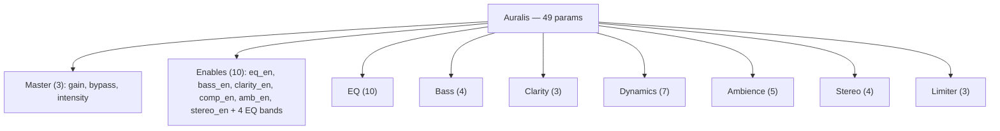

# PARAMETERS.md — Referencia de parámetros

> Fuente de verdad del código: `Source/plugin/ParameterLayout.cpp` (IDs, rangos, defaults, skew) y `Source/plugin/PluginProcessor.cpp` (lectura y aplicación al DSP). Reglas aplicables: `AGENTS.md` §3–§4.
> Docs relacionados: [ARCHITECTURE.md](ARCHITECTURE.md), [DSP-ALGORITHMS.md](DSP-ALGORITHMS.md), [RUNTIME-FLOWS.md](RUNTIME-FLOWS.md), [USER-GUIDE.md](USER-GUIDE.md), [SHORTCUTS-DEBT.md](SHORTCUTS-DEBT.md).

Auralis expone **49 parámetros** (37 `AudioParameterFloat` + 12 `AudioParameterBool`; no hay parámetros `choice` ni `int`), todos con versión de parámetro `1` (`juce::ParameterID { id, 1 }`) y todos automatizables (comportamiento por defecto de JUCE). Los IDs son la API estable: los nombres visibles y las etiquetas pueden cambiar; los IDs no.

Lectura en tiempo real: `cacheParams()` cachea los punteros `std::atomic` una vez en el constructor; `pushParameters()` los lee una vez por bloque y escribe en los procesadores (invocado en `prepareToPlay` y al inicio de cada `processBlock`). Nunca se busca un parámetro por string en el hilo de audio.

## Árbol de parámetros



Orden real de la cadena (`buildPipeline` en `PluginProcessor.cpp`): Gain → EQ → Bass → Clarity → Dynamics → Ambience → Stereo → Limiter.

## 1. Tabla maestra

Tipos de paso: los parámetros lineales (`skew = 1.0`) reciben `interval = 0.01` en el helper `addFloat`; los de frecuencia usan `skew = 0.3` y quedan **continuos** (`interval = 0`); `gain` define su propio intervalo `0.1`. "Label" es la etiqueta de unidad registrada en JUCE (`withLabel`); solo `gain` la tiene. Todas las unidades de la columna "Unidad" son semánticas (deducidas del DSP), no las muestra la GUI salvo el `dB` de `gain`.

### Master (`PluginProcessor.cpp`)

| ID | Nombre visible | Tipo | Rango | Default | Unidad | Escala | Paso | Label | Automat. |
|---|---|---|---|---|---|---|---|---|---|
| `gain` | Master Gain | float | -60 . +12 | 0 | dB | lineal | 0.1 | `dB` | Sí |
| `bypass` | Bypass | bool | false / true | false | - | - | 2 estados | - | Sí |
| `intensity` | Intensity | float | 0 . 1 | 1 | 0..1 (profundidad) | lineal | 0.01 | - | Sí |

### Enables (`ParameterLayout.cpp`)

| ID | Nombre visible | Tipo | Default | Automat. |
|---|---|---|---|---|
| `eq_en` | EQ On | bool | true | Sí |
| `eq_low_en` | EQ Low On | bool | true | Sí |
| `eq_band1_en` | EQ Band1 On | bool | true | Sí |
| `eq_band2_en` | EQ Band2 On | bool | true | Sí |
| `eq_high_en` | EQ High On | bool | true | Sí |
| `bass_en` | Bass On | bool | true | Sí |
| `clarity_en` | Clarity On | bool | true | Sí |
| `comp_en` | Comp On | bool | true | Sí |
| `amb_en` | Ambience On | bool | true | Sí |
| `stereo_en` | Stereo On | bool | true | Sí |

El limitador **no** es conmutable: desactivarlo cambiaría la latencia declarada al host. Los enables desactivan el slot entero del pipeline (`DspPipeline::setEnabled`) o, en el caso del EQ, bandas individuales (`EqualizerProcessor::setBandEnabled`).

### EQ (`ParameterLayout.cpp`)

| ID | Nombre visible | Tipo | Rango | Default | Unidad | Escala | Paso | Label | Automat. |
|---|---|---|---|---|---|---|---|---|---|
| `eq_low_freq` | EQ Low Freq | float | 20 . 500 | 100 | Hz | skew 0.3 | continuo | - | Sí |
| `eq_low_gain` | EQ Low Gain | float | -15 . +15 | 0 | dB | lineal | 0.01 | - | Sí |
| `eq_band1_freq` | EQ Band1 Freq | float | 200 . 2000 | 400 | Hz | skew 0.3 | continuo | - | Sí |
| `eq_band1_gain` | EQ Band1 Gain | float | -15 . +15 | 0 | dB | lineal | 0.01 | - | Sí |
| `eq_band1_q` | EQ Band1 Q | float | 0.1 . 10 | 0.8 | Q | lineal | 0.01 | - | Sí |
| `eq_band2_freq` | EQ Band2 Freq | float | 1000 . 10000 | 2500 | Hz | skew 0.3 | continuo | - | Sí |
| `eq_band2_gain` | EQ Band2 Gain | float | -15 . +15 | 0 | dB | lineal | 0.01 | - | Sí |
| `eq_band2_q` | EQ Band2 Q | float | 0.1 . 10 | 0.8 | Q | lineal | 0.01 | - | Sí |
| `eq_high_freq` | EQ High Freq | float | 2000 . 20000 | 8000 | Hz | skew 0.3 | continuo | - | Sí |
| `eq_high_gain` | EQ High Gain | float | -15 . +15 | 0 | dB | lineal | 0.01 | - | Sí |

### Bass (`ParameterLayout.cpp`)

| ID | Nombre visible | Tipo | Rango | Default | Unidad | Escala | Paso | Label | Automat. |
|---|---|---|---|---|---|---|---|---|---|
| `bass_freq` | Bass Freq | float | 40 . 200 | 100 | Hz | skew 0.3 | continuo | - | Sí |
| `bass_gain` | Bass Gain | float | -12 . +12 | 0 | dB | lineal | 0.01 | - | Sí |
| `bass_saturation` | Bass Saturation | float | 0 . 1 | 0 | 0..1 | lineal | 0.01 | - | Sí |
| `bass_sub_hp` | Bass Sub HP | float | 0 . 60 | 0 | Hz (0 = off) | lineal | 0.01 | - | Sí |

### Clarity (`ParameterLayout.cpp`)

| ID | Nombre visible | Tipo | Rango | Default | Unidad | Escala | Paso | Label | Automat. |
|---|---|---|---|---|---|---|---|---|---|
| `clarity_amount` | Clarity Amount | float | 0 . 1 | 0 | 0..1 | lineal | 0.01 | - | Sí |
| `clarity_freq` | Clarity Freq | float | 1000 . 8000 | 3000 | Hz | skew 0.3 | continuo | - | Sí |
| `clarity_presence` | Clarity Presence | float | -6 . +6 | 0 | dB | lineal | 0.01 | - | Sí |

### Dynamics (`ParameterLayout.cpp`)

| ID | Nombre visible | Tipo | Rango | Default | Unidad | Escala | Paso | Label | Automat. |
|---|---|---|---|---|---|---|---|---|---|
| `comp_threshold` | Comp Threshold | float | -60 . 0 | 0 | dB | lineal | 0.01 | - | Sí |
| `comp_ratio` | Comp Ratio | float | 1 . 20 | 1 | ratio | lineal | 0.01 | - | Sí |
| `comp_attack` | Comp Attack | float | 1 . 100 | 10 | ms | lineal | 0.01 | - | Sí |
| `comp_release` | Comp Release | float | 10 . 1000 | 150 | ms | lineal | 0.01 | - | Sí |
| `comp_knee` | Comp Knee | float | 0 . 24 | 6 | dB | lineal | 0.01 | - | Sí |
| `comp_makeup` | Comp Makeup | float | 0 . 24 | 0 | dB | lineal | 0.01 | - | Sí |
| `comp_rms` | Comp RMS | bool | false / true | false | - | - | 2 estados | - | Sí |

### Ambience (`ParameterLayout.cpp`)

| ID | Nombre visible | Tipo | Rango | Default | Unidad | Escala | Paso | Label | Automat. |
|---|---|---|---|---|---|---|---|---|---|
| `amb_mix` | Ambience Mix | float | 0 . 1 | 0 | 0..1 | lineal | 0.01 | - | Sí |
| `amb_predelay` | Ambience Predelay | float | 0 . 200 | 20 | ms | lineal | 0.01 | - | Sí |
| `amb_decay` | Ambience Decay | float | 0.1 . 10 | 1.5 | s (t60) | lineal | 0.01 | - | Sí |
| `amb_damping` | Ambience Damping | float | 0 . 1 | 0.5 | 0..1 | lineal | 0.01 | - | Sí |
| `amb_width` | Ambience Width | float | 0 . 1 | 0.7 | 0..1 | lineal | 0.01 | - | Sí |

### Stereo (`ParameterLayout.cpp`)

| ID | Nombre visible | Tipo | Rango | Default | Unidad | Escala | Paso | Label | Automat. |
|---|---|---|---|---|---|---|---|---|---|
| `stereo_width` | Stereo Width | float | 0 . 2 | 1 | × | lineal | 0.01 | - | Sí |
| `stereo_mid_gain` | Stereo Mid Gain | float | -12 . +12 | 0 | dB | lineal | 0.01 | - | Sí |
| `stereo_side_gain` | Stereo Side Gain | float | -12 . +12 | 0 | dB | lineal | 0.01 | - | Sí |
| `stereo_balance` | Stereo Balance | float | -1 . +1 | 0 | - | lineal | 0.01 | - | Sí |

### Limiter (`ParameterLayout.cpp`)

| ID | Nombre visible | Tipo | Rango | Default | Unidad | Escala | Paso | Label | Automat. |
|---|---|---|---|---|---|---|---|---|---|
| `lim_threshold` | Limiter Threshold | float | -24 . 0 | 0 | dB | lineal | 0.01 | - | Sí |
| `lim_ceiling` | Limiter Ceiling | float | -12 . 0 | 0 | dB | lineal | 0.01 | - | Sí |
| `lim_release` | Limiter Release | float | 5 . 1000 | 50 | ms | lineal | 0.01 | - | Sí |

## 2. Comportamiento DSP por módulo

### EQ — 4 bandas fijas RBJ

Low shelf y high shelf con Butterworth Q = 1/√2 (cookbook shelf slope S = 1); bandas 1 y 2 peaking con su propio Q. Los coeficientes objetivo se recalculan solo cuando un valor cambia realmente (`setBand` compara antes de marcar dirty) y los coeficientes actuales se interpolan por muestra hacia el objetivo (5 ms): la automatización es continua y sin zipper, y a 0 dB la identidad es bit-exacta. Cada banda puede desactivarse (`setBandEnabled`); una banda desactivada se salta por completo.

| Parámetro (ID) | ↑ = más… | Uso musical y valores sugeridos | Mapeo DSP |
|---|---|---|---|
| `eq_low_freq` | ↑ frecuencia de la esquina del low shelf | 60–120 Hz; default 100 | Coeficientes RBJ, interpolados 5 ms |
| `eq_low_gain` | ↑ graves | ±3–6 dB | Ganancia del low shelf, × intensity |
| `eq_band1_freq` | ↑ centro de la banda 1 | 200–500 Hz (corte de lodo) | Peaking RBJ, interpolado 5 ms |
| `eq_band1_gain` | ↑ corte/refuerzo de lodos | −2 a −4 dB | × intensity |
| `eq_band1_q` | ↑ estrechez | 0.8–1.5 | Q del peaking, interpolado 5 ms |
| `eq_band2_freq` | ↑ centro de la banda 2 | 2–4 kHz (presencia) | Peaking RBJ, interpolado 5 ms |
| `eq_band2_gain` | ↑ presencia | +1 a +3 dB | × intensity |
| `eq_band2_q` | ↑ estrechez | 0.8–1.5 | Q del peaking |
| `eq_high_freq` | ↑ esquina del high shelf | 6–10 kHz | Coeficientes RBJ, interpolados 5 ms |
| `eq_high_gain` | ↑ brillo/aire | +1 a +3 dB | Ganancia del high shelf, × intensity |

→ [DSP-ALGORITHMS.md](DSP-ALGORITHMS.md) (EQ).

### Bass — shelf grave + saturación + protección de sub

Low shelf con coeficientes suavizados 20 ms, saturación `tanh` con drive `k = 1 + 9·s`, mezcla por `s` y compensación de nivel `1 / (1 + 0.25·s·max(0, shelfGainDb/12))`. El sub HP son **dos biquads RBJ en cascada (24 dB/oct, −6 dB en el corte, estilo LR4)**; `0` lo desactiva.

| Parámetro (ID) | ↑ = más… | Uso musical y valores sugeridos | Mapeo DSP |
|---|---|---|---|
| `bass_freq` | ↑ frecuencia de la esquina del shelf | 60–120 Hz; default 100 | Frecuencia shelf; gain/saturación sí se suavizan |
| `bass_gain` | ↑ graves | 0 → +6 dB; preset 5 dB | Ganancia shelf, × intensity |
| `bass_saturation` | ↑ armónicos/distorsión suave | 0–0.5; preset 0.25 | Drive 1 → 10 por `s`, smoothed 20 ms, × intensity, con compensación |
| `bass_sub_hp` | ↑ corte de subgraves | 20–40 Hz para controlar retumbe; 0 = off | 0 = off; (0,10) se eleva a 10 Hz; 24 dB/oct |

→ [DSP-ALGORITHMS.md](DSP-ALGORITHMS.md) (Bass Enhancer).

### Clarity — excitador armónico paralelo

`out = comp · (x + amount · presenceGain · softClip(highpass(x)))` con `softClip(y) = tanh(2y)/tanh(2)` y `comp = 1/(1 + 0.15·amount)`. `amount` se suaviza 30 ms y `presence` 20 ms; con `amount == 0` el camino excitado se salta y la salida es el dry exacto.

| Parámetro (ID) | ↑ = más… | Uso musical y valores sugeridos | Mapeo DSP |
|---|---|---|---|
| `clarity_amount` | ↑ cantidad de excitación | 0.2–0.6; preset 0.45 | Drive del excitador, × intensity |
| `clarity_freq` | ↑ frecuencia de corte del paso alto que alimenta el excitador | 2–5 kHz; preset 3200 | Highpass RBJ Q=0.707 (1000–8000), recalculado por bloque, sin escalar |
| `clarity_presence` | ↑ nivel del camino excitado | 0 → +3 dB; preset 2 | Ganancia lineal `10^(dB/20)`, × intensity |

→ [DSP-ALGORITHMS.md](DSP-ALGORITHMS.md) (Clarity).

### Dynamics — compresor feed-forward estéreo-linkado

Un solo gain compartido, detección sobre el canal más fuerte; `ratio = 1` da pendiente 0, es decir passthrough exacto. Rodilla suave cuadrática de ancho `±knee/2`. `ratio` y `knee` se suavizan 20 ms (ratio clampeado ≥ 1 por muestra). `comp_rms` cambia el detector de pico a RMS (ventana ~10 ms, one-pole sobre `x²`). La reducción de ganancia se publica por bloque como atómico positivo (visible en la GUI como "GR c").

| Parámetro (ID) | ↑ = más… | Uso musical y valores sugeridos | Mapeo DSP |
|---|---|---|---|
| `comp_threshold` | ↑ menos compresión | -30 → -12 dB; default 0 = sin comprimir; preset -18 | dB, smoothed 10 ms; **no** escala con intensity |
| `comp_ratio` | ↑ compresión aplicada | 2–4; default 1 = off; preset 3 | Smoothed 20 ms (clampeado ≥ 1); intensity: `1 + (ratio−1)·i` |
| `comp_attack` | ↑ lentitud del ataque | 10–30 ms; default 10 | Coeficiente one-pole (1–100 ms); no escala con intensity |
| `comp_release` | ↑ lentitud de recuperación | 100–250 ms; default 150 | Coeficiente one-pole (10–1000 ms) |
| `comp_knee` | ↑ anchura de la rodilla | 6–12 dB; default 6 | Smoothed 20 ms, rodilla cuadrática 0–24 dB |
| `comp_makeup` | ↑ ganancia de compensación | 0–6 dB; preset 2 | dB, smoothed 20 ms, × intensity |
| `comp_rms` | (toggle) RMS en vez de pico | off por defecto | `false` = pico, `true` = RMS ~10 ms |

→ [DSP-ALGORITHMS.md](DSP-ALGORITHMS.md) (Dynamics).

### Ambience — reverb FDN de 8 líneas

Entrada sumada a mono → 2 difusores allpass de 1 muestra → predelay → red FDN con realimentación Householder y amortiguación por línea; buses wet a L/R con control de width y mezcla dry/wet. Con `amb_mix < 1e-4` la salida es el dry exacto, pero la red sigue corriendo para que la cola se mantenga caliente. `amb_decay` también define `getTailLengthSeconds()` ante el host.

| Parámetro (ID) | ↑ = más… | Uso musical y valores sugeridos | Mapeo DSP |
|---|---|---|---|
| `amb_mix` | ↑ reverb en la mezcla | 0.05–0.3; default 0; preset 0.15 | Dry/wet, smoothed 30 ms, × intensity |
| `amb_predelay` | ↑ retardo previo | 0–60 ms; default 20 | Retardo (0–200 ms, ring máximo 200 ms) |
| `amb_decay` | ↑ cola más larga | 0.5–3 s; default 1.5; preset 1.2 | t60 (0.1–10 s) → ganancias por línea |
| `amb_damping` | ↑ oscuridad de la cola | 0.3–0.8; default 0.5 | Coeficiente one-pole, smoothed 50 ms: `fc = 18000·10^(−damping)` → 18 kHz → 1.8 kHz |
| `amb_width` | ↑ anchura del wet | 0.5–1; default 0.7 | Smoothed 20 ms; 0 = wet mono, 1 = original; en buffer mono el width cancela |

→ [DSP-ALGORITHMS.md](DSP-ALGORITHMS.md) (Ambience).

### Stereo — M/S

`left = mid·midGain + side·sideGain·width`, `right = mid·midGain − side·sideGain·width`, luego balance. Width, mid, side y **balance** se suavizan 20 ms. En mono la etapa es passthrough exacto y la correlación se reporta 1. La correlación se publica como atómico y se muestra en la GUI.

| Parámetro (ID) | ↑ = más… | Uso musical y valores sugeridos | Mapeo DSP |
|---|---|---|---|
| `stereo_width` | ↑ anchura (hasta 2 = doble side) | 1–1.5; default 1; preset 1.4 | Escala del side, smoothed 20 ms; intensity: `1 + (width−1)·i` |
| `stereo_mid_gain` | ↑ centro | ±3 dB; default 0 | Ganancia del mid, smoothed 20 ms, × intensity |
| `stereo_side_gain` | ↑ laterales | ±3 dB; default 0 | Ganancia del side, smoothed 20 ms, × intensity |
| `stereo_balance` | ↑ desplazamiento hacia la **derecha** (b > 0 atenúa la izquierda) | 0 salvo corrección puntual | Smoothed 20 ms; `b<0` atenúa L, `b>0` atenúa R; **no** escala con intensity |

→ [DSP-ALGORITHMS.md](DSP-ALGORITHMS.md) (Stereo).

### Limiter — lookahead 5 ms

Pico de ventana calculado con un máximo deslizante exacto (cola monótona, O(1) amortizado por muestra): ataque instantáneo (el lookahead expone los picos antes de salir) y release one-pole. El ceiling es un clamp duro que solo actúa si la señal supera el techo. Introduce latencia de `round(0.005 · sampleRate)` muestras, declarada al host con `setLatencySamples`. Es etapa de seguridad: ningún parámetro del limiter escala con `intensity`. La reducción de ganancia se publica por bloque (visible en la GUI como "GR l").

| Parámetro (ID) | ↑ = más… | Uso musical y valores sugeridos | Mapeo DSP |
|---|---|---|---|
| `lim_threshold` | ↑ limita menos | -3 → 0 dB; default 0 | dB → lineal, smoothed 5 ms |
| `lim_ceiling` | ↑ techo (menos recorte duro) | -1 → 0 dB; default 0 | Clamp duro simétrico, sin suavizar |
| `lim_release` | ↑ recuperación más lenta | 20–100 ms; default 50 | One-pole 5–1000 ms |

→ [DSP-ALGORITHMS.md](DSP-ALGORITHMS.md) (Limiter).

## 3. Global intensity

`intensity` es un macro que multiplica la **profundidad** de cada módulo (ganancias, cantidades y anchuras). No toca frecuencias, tiempos ni el limiter. Fórmula exacta, tal como está en `pushParameters()`, con `i = intensity`:

| Módulo | Transformación con `i` | A `i = 0` |
|---|---|---|
| Master Gain | sin cambios | ganancia intacta |
| EQ | `gain·i` en las 4 bandas; freq y Q intactos | 4 biquads en ganancia 0 (respuesta plana) |
| Bass | `shelfGain·i`, `saturation·i`; freq y sub HP intactos | shelf a 0 dB y saturación 0 |
| Clarity | `amount·i`, `presence·i`; freq intacta | camino excitado saltado (dry exacto) |
| Dynamics | `ratio' = 1 + (ratio−1)·i`, `makeup·i`; threshold/attack/release/knee intactos | ratio 1 (passthrough) y makeup 0 |
| Ambience | `mix·i`; predelay/decay/damping/width intactos | mix 0 (dry exacto, red corriendo) |
| Stereo | `width' = 1 + (width−1)·i`, `mid·i`, `side·i`; balance intacto | width 1 y mid/side 0 (identidad) |
| Limiter | sin cambios | sigue limitando con sus ajustes |
| Bypass | sin cambios | sin cambios |

- **`i = 0%`**: cadena neutral — sin EQ, sin realce, sin compresión, sin reverb, sin estéreo — pero **no** es un bypass total: el limiter (y la latencia de 5 ms) siguen activos.
- **`i = 100%`** (default): todos los módulos suenan exactamente como están ajustados.
- Interacción con los controles por módulo: los parámetros de frecuencia/tiempo/Q siguen funcionando siempre; los de cantidad se atenúan proporcionalmente. Subir `intensity` no cambia el carácter, solo cuánto se aplica. La GUI lo muestra como slider en la barra superior.

## 4. Bypass

- `bypass` es un `AudioParameterBool` (default `false`) que se devuelve como parámetro de bypass del host (`getBypassParameter`).
- **Bypass real de toda la cadena**: con `bypass > 0.5`, `processBlock` llama a `pushNeutralParameters()` en vez de `pushParameters()`: todos los procesadores reciben sus valores neutros (verificados como passthrough exacto por los tests unitarios). Las transiciones son sin clics gracias a los suavizados internos, la línea de retardo del limiter sigue avanzando (la latencia declarada permanece válida) y la salida es la señal seca. Única excepción intencional: picos por encima de 0 dBFS siguen tocando el clamp de techo 0 dB del limiter.
- Estado: al ser un parámetro más, se lee/guarda con todos los demás — estado del host, presets (aplicar/guardar itera sobre todos los parámetros), A/B (`snapshotTo`/`restoreFrom`) y `Reset` (`resetToDefaults`).

## 5. Contrato de estabilidad y formato de estado

Regla de `AGENTS.md` §4: **los IDs de parámetro son API estable**; nunca se renombran ni se reutilizan, solo se añaden IDs nuevos. Cambiar un rango o un default exige nota en la descripción del PR.

| Cambio | Efecto sobre presets y estado guardado |
|---|---|
| Añadir parámetro con ID nuevo | Seguro. Los estados/presets antiguos no lo incluyen y conserva su default |
| Cambiar nombre visible, label o descripción | Seguro (no forma parte del ID) |
| Cambiar el default | No rompe el estado guardado (los valores van guardados), pero cambia el comportamiento al insertar el plugin; documentar en el PR |
| Cambiar rango, skew o paso | Los valores reales guardados se reinterpretan/clampan al nuevo rango; los slots A/B (valores normalizados 0..1) cambian de significado en silencio. Evitar; si es imprescindible, documentar |
| Renombrar o reutilizar un ID | **Rompe** automatización del host, presets de usuario, A/B y estado. Prohibido |
| Eliminar un parámetro | Rompe automatización y presets; la clave queda huérfana. Prohibido sin migración |
| Cambiar el mapeo interno DSP (manteniendo rango/ID) | Seguro para presets; cambia el sonido. Documentar en el PR |

**Estado del host (APVTS, XML binario)**:
- Raíz `PARAMS` (tipo creado en el constructor, con undo manager `nullptr`).
- `schema_version` como atributo de la raíz, valor `1` (`PresetManager::schemaVersion`).
- Los valores se guardan **en unidades reales** (APVTS escribe `unnormalisedValue`).
- Hijo `Slots`: `active` (0/1) y las dos instantáneas `AbState` con `index`; cada slot guarda **valores normalizados 0..1** (`snapshotTo`). Se elimina del árbol al cargar.
- `setStateInformation` exige tag `PARAMS`; un estado sin `schema_version` se trata como versión 1 (hook de migración).

**Preset de usuario (`*.auralis`, JSON)** — `PresetManager`:
```json
{ "schema_version": 1, "name": "Mi Preset", "params": { "eq_low_gain": 2.0, "clarity_amount": 0.4 } }
```
`fromJson` rechaza cualquier versión distinta de la actual: para evolucionar el esquema hay que subir `schemaVersion` y añadir migración. `applyPreset` ignora IDs desconocidos y solo toca los presentes en el preset; `saveUserPreset` guarda los 49 parámetros en unidades reales. Flujo completo del ciclo de vida en [RUNTIME-FLOWS.md](RUNTIME-FLOWS.md).

## 6. Defaults de fábrica (estado al insertar por primera vez)

Salida directa de la tabla maestra: al insertar el plugin la cadena es neutral (todo a 0/off, `intensity = 1`, todos los enables activos) y `Reset` restaura exactamente estos valores.

| Módulo | ID = default | | |
|---|---|---|---|
| Master | `gain` = 0 dB | `bypass` = false | `intensity` = 1 |
| Enables | todos = true | | |
| EQ | `eq_low_freq` = 100 Hz | `eq_low_gain` = 0 dB | `eq_band1_freq` = 400 Hz |
| | `eq_band1_gain` = 0 dB | `eq_band1_q` = 0.8 | `eq_band2_freq` = 2500 Hz |
| | `eq_band2_gain` = 0 dB | `eq_band2_q` = 0.8 | `eq_high_freq` = 8000 Hz |
| | `eq_high_gain` = 0 dB | | |
| Bass | `bass_freq` = 100 Hz | `bass_gain` = 0 dB | `bass_saturation` = 0 |
| | `bass_sub_hp` = 0 (off) | | |
| Clarity | `clarity_amount` = 0 | `clarity_freq` = 3000 Hz | `clarity_presence` = 0 dB |
| Dynamics | `comp_threshold` = 0 dB | `comp_ratio` = 1 (off) | `comp_attack` = 10 ms |
| | `comp_release` = 150 ms | `comp_knee` = 6 dB | `comp_makeup` = 0 dB |
| | `comp_rms` = false | | |
| Ambience | `amb_mix` = 0 | `amb_predelay` = 20 ms | `amb_decay` = 1.5 s |
| | `amb_damping` = 0.5 | `amb_width` = 0.7 | |
| Stereo | `stereo_width` = 1 | `stereo_mid_gain` = 0 dB | `stereo_side_gain` = 0 dB |
| | `stereo_balance` = 0 | | |
| Limiter | `lim_threshold` = 0 dB | `lim_ceiling` = 0 dB | `lim_release` = 50 ms |

En este estado la cadena es transparente: cada procesador es passthrough exacto con sus defaults (verificado por test por procesador y por la cadena completa).
