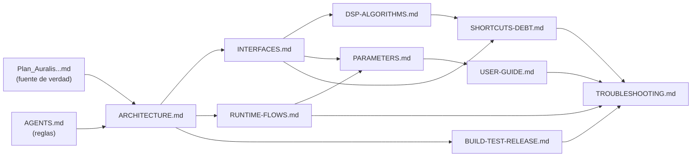

# Documentación de Auralis

Índice de toda la documentación del proyecto. Cada documento describe el **código real en HEAD** (v0.2.0, commit `3fcee43`): si el plan y el código difieren, la documentación describe el código y señala la diferencia.

Fuente de verdad del producto: `Plan_Auralis_VST3_Cpp_JUCE_OpenSource.md`. Reglas aplicables en revisión: `AGENTS.md`. Definición de producto resumida: [PRODUCT.md](PRODUCT.md).

## Datos rápidos

| Dato | Valor |
|---|---|
| Producto | Auralis — plugin VST3 de mejora de audio (efecto) |
| Versión | 0.2.0 (CMakeLists.txt, `project(Auralis VERSION 0.2.0)`) |
| Plataforma | Windows 10/11 x64, host prioritario: FL Studio |
| Stack | C++20, JUCE 9 (submódulo), CMake ≥ 3.22, MSVC/VS2022 |
| Licencia | AGPL-3.0-only |
| Cadena DSP | `Gain → EQ → Bass → Clarity → Dynamics → Ambience → Stereo → Limiter` (fija) |
| Parámetros | 39 IDs estables (36 float + bypass + gain + intensity) |
| Tests | 10 ficheros unitarios (`tests/unit/Test*.cpp`), binario `auralis_tests` |
| Validación | pluginval strictness 8 en CI |
| Artefacto | `build/Auralis_artefacts/Release/VST3/Auralis.vst3` / ZIP de CI con SHA256 |

## Mapa de documentos

| Documento | Qué cubre | Audiencia principal |
|---|---|---|
| [PRODUCT.md](PRODUCT.md) | Qué es Auralis, usuario objetivo, propuesta de valor, fuera de alcance | Todo el mundo |
| [USER-GUIDE.md](USER-GUIDE.md) | Instalación, uso en FL Studio, tour de la interfaz, recetas por caso de uso, FAQ, glosario | Usuario final |
| [ARCHITECTURE.md](ARCHITECTURE.md) | Capas, diagramas C4 (contexto/contenedor/componente), límites entre capas, modelo de hilos, receta para añadir un efecto | Desarrollador, revisor |
| [INTERFACES.md](INTERFACES.md) | Referencia clase a clase, contratos (`IDspProcessor`, `DspTypes`), inventario de archivos, checklists de extensión | Desarrollador, mantenedor |
| [DSP-ALGORITHMS.md](DSP-ALGORITHMS.md) | Matemática y algoritmos de cada módulo DSP y del análisis espectral, mapeos parámetro→coeficiente, edge cases | Desarrollador DSP, revisor |
| [PARAMETERS.md](PARAMETERS.md) | Tabla maestra de los 39 parámetros: ID, rango, default, skew, unidad, semántica, control global Intensity | Desarrollador, soporte, power user |
| [RUNTIME-FLOWS.md](RUNTIME-FLOWS.md) | Ciclo de vida completo, `processBlock` paso a paso, hilos, estado, presets, A/B, analizador→GUI | Desarrollador, soporte |
| [BUILD-TEST-RELEASE.md](BUILD-TEST-RELEASE.md) | Prerrequisitos, build, tests (inventario), CI, pluginval, empaquetado e instalación, checklist de release | Desarrollador, release manager |
| [SHORTCUTS-DEBT.md](SHORTCUTS-DEBT.md) | Deuda técnica: 5 shortcuts marcados + hallazgos no marcados, priorización, protocolo | Mantenedor, revisor |
| [TROUBLESHOOTING.md](TROUBLESHOOTING.md) | Manual de soporte: síntoma→causa→solución, diagnóstico PowerShell, triaje de crashes, interpretación de pluginval | Soporte, mantenedor, usuario avanzado |

Rutas de documentos relativos a `docs/`. Desde fuera de `docs/`, prefijar con `docs/`.

## Por dónde empezar (según tu rol)

- **Usuario final**: [USER-GUIDE.md](USER-GUIDE.md) → si algo falla, [TROUBLESHOOTING.md](TROUBLESHOOTING.md).
- **Desarrollador que llega nuevo**: [PRODUCT.md](PRODUCT.md) → [ARCHITECTURE.md](ARCHITECTURE.md) → [INTERFACES.md](INTERFACES.md) → [DSP-ALGORITHMS.md](DSP-ALGORITHMS.md) para el módulo que toque. Antes de escribir código, releeer `AGENTS.md`.
- **Quien revisa un PR**: reglas en `AGENTS.md`, límites de capas en [ARCHITECTURE.md](ARCHITECTURE.md), matemática afectada en [DSP-ALGORITHMS.md](DSP-ALGORITHMS.md), y comprobar si el PR toca un shortcut de [SHORTCUTS-DEBT.md](SHORTCUTS-DEBT.md).
- **Soporte/soporte a usuarios**: [TROUBLESHOOTING.md](TROUBLESHOOTING.md) + [RUNTIME-FLOWS.md](RUNTIME-FLOWS.md) para explicar comportamientos internos.
- **Release manager**: [BUILD-TEST-RELEASE.md](BUILD-TEST-RELEASE.md) + checklist de [SHORTCUTS-DEBT.md](SHORTCUTS-DEBT.md).

## Relación entre documentos

## Cómo mantener esta documentación

1. **Regla del mismo PR**: si un cambio de código altera lo que aquí se documenta (rangos de parámetros, algoritmos, flujos, build), el PR actualiza el/los documentos afectados. Los IDs de parámetros son API estable: solo se añaden, nunca se renombran (ver [PARAMETERS.md](PARAMETERS.md)).
2. **Shortcuts**: todo `// shortcut:` nuevo en el código se registra en [SHORTCUTS-DEBT.md](SHORTCUTS-DEBT.md) con límite y plan de mejora (protocolo en ese documento).
3. **Verificación**: los documentos citan archivos y líneas del código. Si encuentras una cita que no coincide, es un bug de documentación: corrígelo en el mismo PR que el código, o reporta un issue.

## Estado y temas calientes (v0.2.0)

Temas abiertos que quien dé soporte debe conocer (detalle y evidencia en [SHORTCUTS-DEBT.md](SHORTCUTS-DEBT.md)):

- El **bypass** del host solo silencia la etapa de Master Gain (`PluginProcessor.cpp:111`): el resto de la cadena sigue procesando. Confirmar si es la semántica deseada antes de 1.0.
- Los **coeficientes del EQ se recalculan cada bloque** sin suavizado: zipper leve al automatizar.
- El **limiter** escanea la ventana con coste O(N·L) (sin perfilado aún).
- No hay tests del adaptador JUCE (solo DSP/análisis); estado/presets sin cobertura automatizada.
