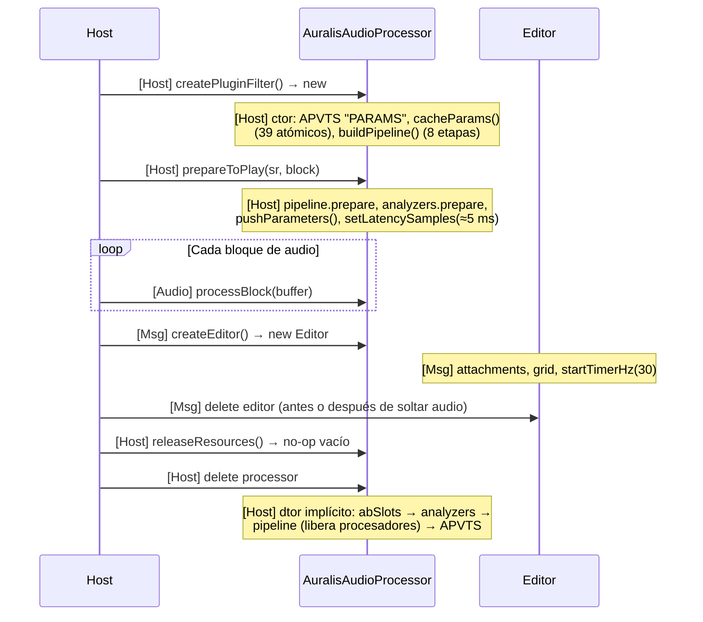
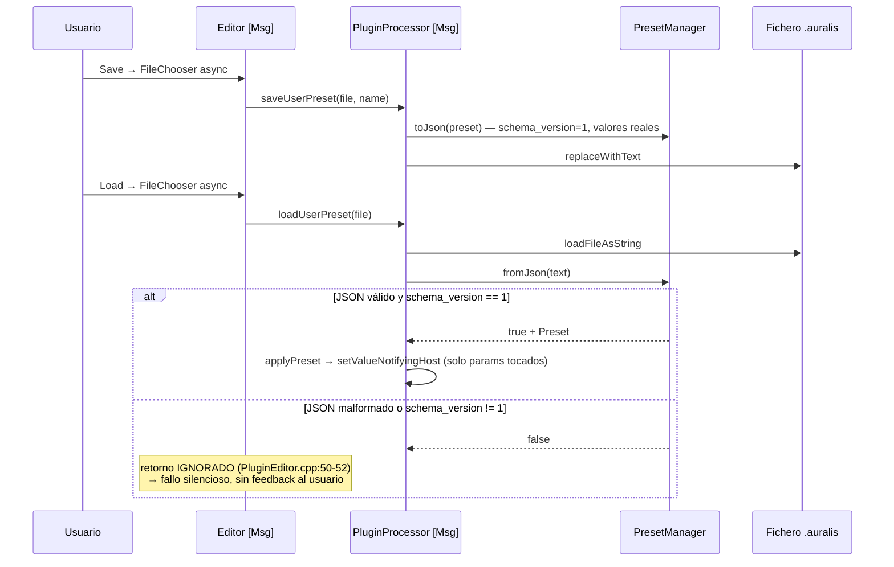
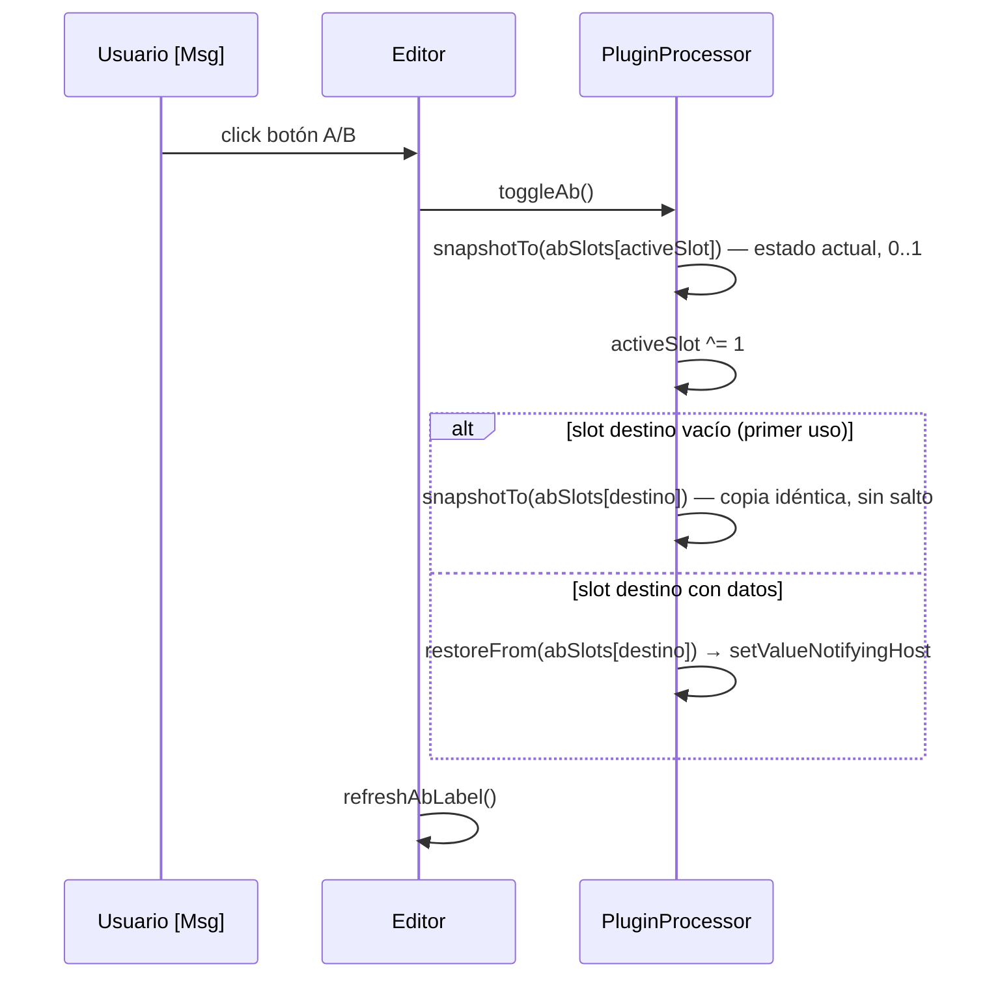
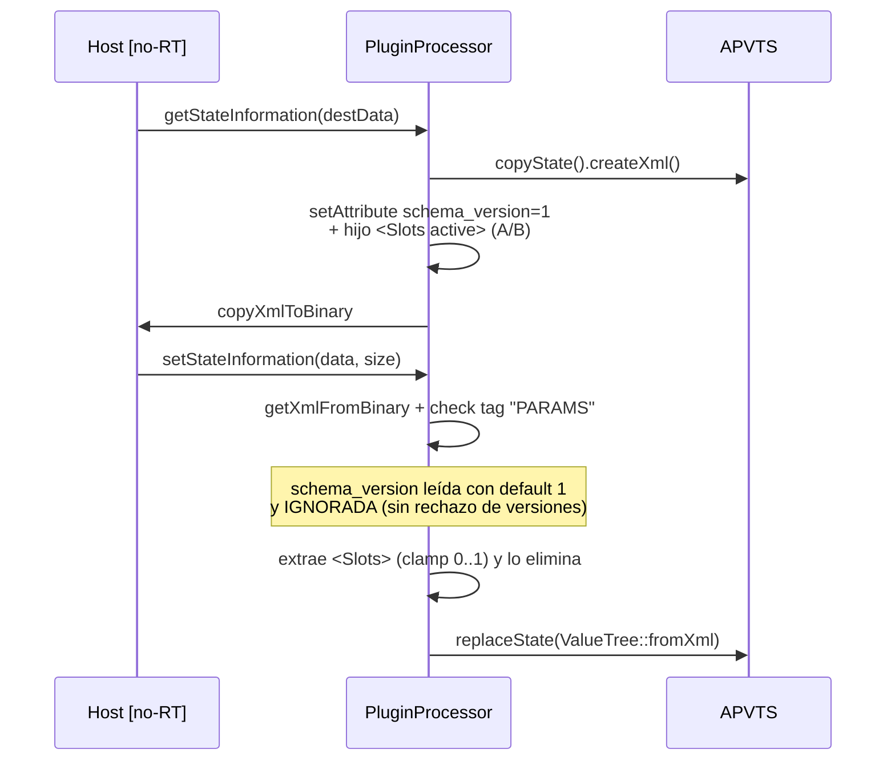

# Runtime Flows — flujos end-to-end, hilos y memoria

Documenta el comportamiento **real** del código en `HEAD` (commit `3fcee43`). Cada flujo fue verificado contra las fuentes citadas. Complementa a [ARCHITECTURE.md](ARCHITECTURE.md) (capas), [DSP-ALGORITHMS.md](DSP-ALGORITHMS.md) (matemática de cada etapa), [PARAMETERS.md](PARAMETERS.md) (IDs y rangos), [INTERFACES.md](INTERFACES.md) (contratos) y [SHORTCUTS-DEBT.md](SHORTCUTS-DEBT.md) (deuda declarada). Para síntomas en el host, ver [TROUBLESHOOTING.md](TROUBLESHOOTING.md).

Hilos que aparecen en todo el documento:

| Etiqueta | Hilo |
|---|---|
| **[Host]** | Hilo(s) del host que llaman a la API del plugin |
| **[Audio]** | Hilo de audio en tiempo real (`processBlock`) |
| **[Msg]** | Message thread de JUCE (GUI, timers, callbacks asíncronos) |

---

## 1. Ciclo de vida del plugin

Origen: `createPluginFilter()` en `Source/plugin/PluginProcessor.cpp:309` hace `new AuralisAudioProcessor()`. El constructor declara buses estéreo (`PluginProcessor.cpp:8-11`; mono también aceptado, ver `isBusesLayoutSupported`, líneas 93-102), crea el APVTS (`"PARAMS"`, layout en `Source/plugin/ParameterLayout.cpp`) y ejecuta **todo** el setup en el hilo del host:

- `cacheParams()` (líneas 18-59): cachea ~39 punteros `std::atomic<float>*` vía `apvts.getRawParameterValue(id)` — nunca se buscan por string en tiempo real.
- `buildPipeline()` (líneas 61-80): añade los 8 procesadores a `auralis::DspPipeline` con `make_unique`; el pipeline guarda `std::vector<Slot>` (reservado solo aquí; `modules/dsp_pipeline/DspPipeline.h:35` — "never resized once prepare was called").

`prepareToPlay` (líneas 82-89): `pipeline.prepare(ctx)`, `analyzerIn/Out.prepare(sr, block)`, `pushParameters()` y `setLatencySamples(limiterProcessor->getLatencySamples())`. No hay límites propios de sample rate o block size: el código acepta lo que el host ofrezca (mono/estéreo, cualquier `samplesPerBlock`; los analizadores copian `min(nf, 1024)` muestras por FFT). `releaseResources()` es **vacío** (línea 91).

Destrucción: orden inverso a la declaración (`PluginProcessor.h:116-133`): `abSlots` → analizadores → punteros crudos (no poseen) → `pipeline` (destruye los procesadores vía `unique_ptr`) → APVTS.



---

## 2. `processBlock` paso a paso

Fuente: `Source/plugin/PluginProcessor.cpp:151-166`.

1. `juce::ScopedNoDenormals` — evita denormales en todo el bloque. **[Audio]**
2. `pushParameters()` (líneas 104-149): lee los ~39 atómicos cacheados y llama a los setters de cada etapa (métodos `noexcept`, "call once per block"). **[Audio]**
3. Construye `auralis::AudioBufferView` con `getWritePointer` — procesamiento **in-place, sin copia**. Canales: `min(buffer.getNumChannels(), getTotalNumOutputChannels())` → mono o estéreo. **[Audio]**
4. `analyzerIn.process(view)` — observador de solo lectura, pre-cadena. **[Audio]**
5. `pipeline.process(view)` (`modules/dsp_pipeline/DspPipeline.cpp:20-25`): itera los 8 slots fijos; salta los `enabled == false`. Orden real: **Gain → EQ → Bass → Clarity → Dynamics → Ambience → Stereo → Limiter**. **[Audio]**
6. `analyzerOut.process(view)` — post-cadena. **[Audio]**

### Comportamiento REAL del bypass

El parámetro `bypass` (`AudioParameterBool`, `Source/plugin/ParameterLayout.cpp:31`; expuesto al host en `getBypassParameter()`, `PluginProcessor.cpp:304-307`) **solo alcanza a la etapa de master gain**:

```cpp
// PluginProcessor.cpp:111
gainProcessor->setBypass (params.bypass->load() > 0.5f);
```

Con `bypass == true`, `GainProcessor::process` retorna inmediatamente y el buffer queda como entrada (paso directo **de esa etapa**, `modules/dsp/gain/GainProcessor.cpp:17-18`). Las otras 7 etapas **siguen procesando audio**: EQ, Bass, Clarity, Dynamics, Ambience, Stereo y Limiter se aplican igual. `DspPipeline::setEnabled()` existe (`DspPipeline.cpp:34-38`) pero **nadie lo llama desde `Source/`** — no hay bypass por etapa. Si el host silencia la llamada a `processBlock` al activar su bypass, ese comportamiento depende del host, no del plugin.

```mermaid
sequenceDiagram
    participant H as Host
    participant P as processBlock [Audio]
    participant A as analyzerIn
    participant DP as DspPipeline
    participant O as analyzerOut

    H->>P: buffer (mono/estéreo)
    Note over P: ScopedNoDenormals
    P->>P: pushParameters() — lee 39 atómicos,<br/>setters noexcept por etapa
    P->>A: AudioBufferView (in-place, solo lectura)
    Note over A: RMS/peak/peakHold cada bloque;<br/>FFT cada 2.º bloque
    P->>DP: process(view)
    Note over DP: Gain → EQ → Bass → Clarity →<br/>Dynamics → Ambience → Stereo → Limiter
    Note over DP: bypass=true ⇒ SOLO Gain retorna sin procesar;<br/>el resto de la cadena sigue activa
    P->>O: process(view)
    P-->>H: buffer modificado
```

### Safeguards de NaN

- `ScopedNoDenormals` evita denormales (`PluginProcessor.cpp:153`).
- `storeDb()` (`modules/analysis/SpectrumAnalyzer.cpp:19-23`): cualquier valor no estrictamente positivo (NaN incluido) cae al suelo de −100 dB; nunca entra NaN en los atómicos de metering.
- El limiter hace clamp duro a ±ceiling (`modules/dsp/limiter/LimiterProcessor.cpp:69-72`).
- Las etapas operan en `float` sin realimentación inestable documentada (ver [DSP-ALGORITHMS.md](DSP-ALGORITHMS.md)).

### Lo que NO ocurre en la ruta de audio

Sin `new`/`malloc`/`resize` (los vectores de los analizadores y las líneas del Ambience se dimensionan en `prepare`), sin mutex/locks, sin E/S de ficheros o registro, sin llamadas al `MessageManager`, sin logging, sin búsqueda de parámetros por string. Detalle de cada punto en la checklist de la sección 12.

---

## 3. Cambio de parámetro (GUI / automatización → DSP)

No hay `APVTS::Listener` ni `SmoothedValue` de JUCE. El flujo es: el attachment (o el host) escribe el parámetro en el APVTS en el **[Msg]**; el valor llega al DSP cuando el siguiente `processBlock` ejecuta `pushParameters()` leyendo el atómico en **[Audio]**.

**El smoothing vive dentro de cada procesador DSP** (`modules/audio_core/Smoother.h`, one-pole), no en la capa plugin:

| Etapa | Suavizado | Sin suavizar (salto directo) |
|---|---|---|
| Gain | target de gain, one-pole ~20 ms (`modules/dsp/gain/GainProcessor.cpp:11,28`) | bypass (bool) |
| EQ | — | freq, gain y Q de las 4 bandas: coeficientes RBJ recomputados al detectar `dirty` (salto declarado como *shortcut*, `modules/dsp/equalizer/EqualizerProcessor.h:12-13`) |
| Bass | coeficientes del shelf + saturación, 20 ms (`modules/dsp/bass/BassEnhancerProcessor.cpp:20-25`) | shelfFreq, sub-highpass |
| Clarity | amount 30 ms, presence 20 ms (`modules/dsp/clarity/ClarityProcessor.h:20-22`) | centerFreq (biquad recomputado al instante) |
| Dynamics | threshold 10 ms, makeup 20 ms (`modules/dsp/dynamics/CompressorProcessor.cpp:20-21`) | attack, release, knee, ratio, RMS mode |
| Ambience | mix 30 ms (`modules/dsp/ambience/AmbienceProcessor.cpp:39`) | predelay, decay, damping, width |
| Stereo | width, mid, side 20 ms (`modules/dsp/stereo/StereoEnhancerProcessor.cpp:12-23`) | balance (documentado, `StereoEnhancerProcessor.h:24`) |
| Limiter | threshold 5 ms (`modules/dsp/limiter/LimiterProcessor.cpp:23,56`) | ceiling, release (coeficiente recomputado por bloque) |

```mermaid
sequenceDiagram
    participant G as GUI/Automación
    participant AP as APVTS
    participant P as PluginProcessor
    participant D as Procesador DSP

    G->>AP: [Msg] attachment / automation escribe valor
    Note over AP: valor almacenado + atómico actualizado
    AP-->>P: (sin listener; nada ocurre hasta el bloque siguiente)
    Note over P: [Audio] siguiente processBlock → pushParameters()
    P->>P: params.xxx->load() (atómico cacheado)
    P->>D: setter (p. ej. setThresholdDb)
    Note over D: [Audio] Smoother::setTarget — convergencia<br/>one-pole durante el bloque (si la etapa suaviza)
```

---

## 4. Global intensity

Mecanismo real: `pushParameters()` (`Source/plugin/PluginProcessor.cpp:104-149`). Cada bloque, `i = params.intensity->load()` (0..1) y se aplican las fórmulas:

| Parámetro | Fórmula aplicada |
|---|---|
| Ganancias EQ (4 bandas) | `gain * i` |
| Bass shelf gain / saturación | `valor * i` |
| Clarity amount / presence | `valor * i` |
| Comp ratio | `1.0f + (ratio - 1.0f) * i` (ratio 1 = neutro) |
| Comp makeup | `valor * i` |
| Ambience mix | `valor * i` |
| Stereo width | `1.0f + (w - 1.0f) * i` (1 = neutro) |
| Stereo mid/side gain | `valor * i` |

**No se escalan** (comentario en `PluginProcessor.cpp:106-107`): frecuencias, tiempos (attack/release/predelay/decay/damping), el limiter completo (etapa de seguridad), el master gain y el bypass. Hilo: **[Audio]**, una vez por bloque. El cambio de intensidad es tan suave como el smoothing de cada etapa (sección 3).

---

## 5. Presets

**De fábrica**: hardcodeados en `Source/presets/PresetManager.cpp:7-23` (`factoryPresets()`): *Warm Bass*, *Vocal Clarity*, *Wide Stereo*. No hay ficheros; el editor los carga al ComboBox en su constructor (`Source/plugin/PluginEditor.cpp:26-27`) y `presetBox.onChange` llama `processor.applyPreset(...)` (línea 29-30).

**Guardar**: botón Save → `juce::FileChooser` asíncrono ([Msg], `PluginEditor.cpp:32-42`) → `saveUserPreset(file, name)` (`PluginProcessor.cpp:184-192`): construye un `Preset` con los valores **reales** de todos los parámetros (`convertFrom0to1`), serializa con `PresetManager::toJson` a

```json
{"schema_version":1,"name":"...","params":{"bass_gain":5.0,...}}
```

y escribe con `file.replaceWithText(...)` (extensión `.auralis`). E/S de fichero **solo** en [Msg].

**Cargar**: botón Load → `FileChooser` asíncrono → `loadUserPreset(file)` (`PluginProcessor.cpp:194-201`). `PresetManager::fromJson` (`Source/presets/PresetManager.cpp:39-58`) devuelve `false` ante JSON malformado **o `schema_version != 1`** (fallo silencioso desde el punto de vista del usuario). **Verificado**: el callback del editor **ignora el retorno bool** (`PluginEditor.cpp:50-52`) — si el fichero falla, no hay mensaje ni cambio de estado.

**Aplicar**: `applyPreset` (`PluginProcessor.cpp:170-175`) recorre `preset.values` y llama `setValueNotifyingHost(convertTo0to1(value))` **solo** a los parámetros que el preset toca; el resto conserva su valor. Todo en [Msg]; el salto audible queda amortiguado por los smoothers de la sección 3.



---

## 6. A/B

Implementación: `Source/plugin/PluginProcessor.cpp:203-232` + estado en `PluginProcessor.h:131-133`.

- Cada slot es un `juce::ValueTree("AbState")` con **una propiedad por parámetro en valor normalizado 0..1** (`snapshotTo`, línea 208).
- `toggleAb()` (líneas 219-227): 1) snapshot del estado **actual** al slot activo; 2) alterna `activeSlot ^= 1`; 3) si el slot destino nunca se usó (0 propiedades), se le copia el snapshot idéntico → primer cambio A↔B sin salto; 4) si ya tenía datos, `restoreFrom` escribe cada valor con `setValueNotifyingHost`.
- **No existe** "copiar A→B"; solo alternar. La etiqueta del botón viene de `getAbLabel()` ("A"/"B"), refrescada por el editor (`PluginEditor.cpp:56-61,133-136`).
- Los slots **viajan dentro del estado del host** (sección 7). Al cerrar/guardar el proyecto se persiste el último snapshot hecho por un toggle: si el usuario movió parámetros después del último A↔B, el slot guardado conserva el valor del toggle, no el valor vivo actual.



---

## 7. Estado del host (`getStateInformation` / `setStateInformation`)

Fuente: `Source/plugin/PluginProcessor.cpp:260-302`. Formato real: **XML del APVTS** (árbol `"PARAMS"` con todos los parámetros), binarizado con `copyXmlToBinary`/`getXmlFromBinary`. El host llama ambos en un hilo no-RT (**[Host]/[Msg]**), típicamente al guardar/reabrir el proyecto.

- **Guardar**: `apvts.copyState().createXml()` + atributo `schema_version = 1` (`PresetManager::schemaVersion`) + hijo `<Slots active="…">` con el XML de los dos slots A/B; luego `copyXmlToBinary`.
- **Cargar**: valida el tag raíz (`apvts.state.getType()`), lee `schema_version` con default 1 para estados antiguos (línea 288-289, "migration hook")… y **lo ignora** (`juce::ignoreUnused(schema)`, línea 290): a diferencia de los presets, un estado con versión futura **no se rechaza**. Extrae `<Slots>` (con clamp de índices 0..1), lo elimina del XML y finalmente `apvts.replaceState(ValueTree::fromXml(*xml))`.

Compatibilidad: estados de versiones sin `schema_version` se tratan como v1 y cargan; no hay migraciones reales implementadas todavía.



---

## 8. Analizador → GUI

Escritor: **[Audio]** en `SpectrumAnalyzer::process` (`modules/analysis/SpectrumAnalyzer.cpp:59-88`) — RMS, peak y peakHold cada bloque (el peakHold decae 0.005/bloque sin picos nuevos); la FFT (radix-2, **1024 puntos**, ventana Hann, `modules/analysis/Fft.h:8-10`) corre **cada 2.º bloque** (`blockCounter & 1`) y publica 32 bandas log-espaciadas 20 Hz–20 kHz, normalizadas 0..1 (`mag * 4/n`, clamp a 1.0, líneas 113-123).

Mecanismo exacto: **sin cola y sin locks** — cada valor es un `std::atomic<float>` público leído con `memory_order_relaxed` (`SpectrumAnalyzer.h:24-28`). La correlación de estéreo es el mismo patrón: `StereoEnhancerProcessor::correlation` atómico (`modules/dsp/stereo/StereoEnhancerProcessor.h:35,27-28`), leído por la GUI vía `getStereoCorrelationAtomic()`.

Lector: **[Msg]** — el `Timer` del editor a **30 Hz** (`startTimerHz(30)`, `PluginEditor.cpp:79`) solo llama `spectrum.repaint()` (`PluginEditor.cpp:138-141`); `SpectrumView::paint` carga los atómicos de ambos analizadores (`Source/ui/SpectrumView.cpp:40-60`).

Política de datos descartados: no hay cola que llenarse — el audio sobrescribe el último valor y la GUI siempre pinta el más reciente; los datos intermedios se descartan implícitamente. Matiz: las 32 bandas no forman un snapshot coherente entre sí (cada atómico se lee por separado), lo cual es aceptable para visualización; el peakHold, RMS y correlación sí son valores únicos atómicos.

```mermaid
sequenceDiagram
    participant A as analyzerIn/Out [Audio]
    participant S as spectrum (atomics)
    participant T as Timer editor [Msg 30 Hz]
    participant V as SpectrumView::paint

    loop Cada bloque de audio
        A->>S: rmsDb, peakDb, peakHoldDb.store (relaxed)
        Note over A: FFT (1024, Hann) cada 2.º bloque
        A->>S: band[0..31].store (relaxed, 0..1)
    end
    loop Cada tick (30 Hz)
        T->>V: spectrum.repaint()
        V->>S: band[], rmsDb, peakHoldDb.load (relaxed)
        Note over V: también correlation.load desde StereoEnhancer
        V->>V: dibuja barras in/out + peak trace + línea de meters
    end
    Note over S: sin cola: el último valor gana,<br/>los intermedios se descartan; sin locks
```

---

## 9. Editor: attach, proceso y desmontaje

- **Attach**: en el constructor ([Msg], `Source/plugin/PluginEditor.cpp:19-83`) se crean `SliderAttachment` para `intensity`, `ButtonAttachment` para `bypass`, y `buildParamGrid()` genera un slider/toggle **con su attachment** por cada parámetro que no sea de la top bar (`gain`, `intensity`, `bypass`, líneas 13-16 y 85-131).
- **Proceso**: ningún `APVTS::Listener`; los widgets escriben al APVTS y la GUI se entera de cambios externos (automación, presets) porque los attachments sincronizan los valores. El `Timer` a 30 Hz solo repinta el espectro.
- **Repaint**: `timerCallback` → `spectrum.repaint()`; el resto de la GUI repinta por eventos normales de JUCE.
- **Desmontaje**: destructor implícito. Orden seguro por construcción: el `Timer` se detiene al destruir el `Component`; los attachments se liberan con los miembros; `fileChooser` es `unique_ptr` y se reemplaza en cada apertura. `SpectrumView` guarda **referencias** a `analyzerIn/Out` y al atómico de correlación, todos propiedad del processor — seguro porque el editor siempre vive menos que el processor. El host borra el editor; `AuralisAudioProcessor` es `friend` del editor pero no hay acoplamiento adicional.

```mermaid
sequenceDiagram
    participant H as Host [Msg]
    participant E as Editor
    participant AP as APVTS

    H->>E: new Editor(processor)
    Note over E: attachments (intensity, bypass, grid),<br/>combobox presets, callbacks de botones,<br/>startTimerHz(30), setSize(900, 640)
    loop vida del editor
        E->>AP: widgets escriben vía attachments
        AP-->>E: attachments reflejan cambios externos<br/>(automación, presets, A/B)
        E->>E: Timer 30 Hz → spectrum.repaint()
    end
    H->>E: delete editor
    Note over E: ~Timer detiene el timer;<br/>attachments liberados; FileChooser unique_ptr
```

---

## 10. Apagado y render offline

- `releaseResources()` es un no-op (`PluginProcessor.cpp:91`): **no** llama a `pipeline.reset()` — ese método existe (`DspPipeline.cpp:27-32`) pero nadie lo invoca desde `Source/` (solo úsalo test/unit). El estado DSP se limpia únicamente cuando el host vuelve a llamar `prepareToPlay`: cada procesador reinicia buffers y estados en `prepare` y los `Smoother::prepare` hacen *snap* para evitar zipper al recargar (p. ej. `modules/dsp/gain/GainProcessor.cpp:12`, `modules/dsp/stereo/StereoEnhancerProcessor.cpp:17`).
- **Latencia declarada**: `setLatencySamples(limiterProcessor->getLatencySamples())` en `prepareToPlay` (`PluginProcessor.cpp:88`); el lookahead del limiter es `round(0.005 * sampleRate)` → **221 muestras @44.1 kHz, 240 @48 kHz, 480 @96 kHz** (`modules/dsp/limiter/LimiterProcessor.cpp:18`). El host puede compensar (PDC).
- **Tail**: `getTailLengthSeconds()` devuelve los segundos de decay del Ambience (`PluginProcessor.cpp:249-252`), para que el host dimensione buffers de cola.
- **Render offline**: mismo `processBlock`, sin atajos dependientes del tiempo real; no hay suposiciones de tamaño de bloque (el copiado FFT usa `min(nf, 1024)` y las etapas iteran `nf`); variable block sizes y mono/estéreo funcionan por construcción del `AudioBufferView`.
- **Orden de destrucción**: revisado en la sección 1 — los analizadores se destruyen antes del pipeline, pero ningún procesador los referencia, así que no hay uso tras liberación.

---

## 11. Tabla de propiedad de hilos (thread ownership)

| Objeto | Hilo(s) que lo tocan | Sincronización |
|---|---|---|
| `AuralisAudioProcessor` (ctor/dtor, `prepareToPlay`, `releaseResources`) | [Host]/[Msg] | Llamadas del host; sin concurrencia con audio |
| `apvts` (valores de parámetros) | Escribe [Msg] (attachments, presets, A/B, host); lee [Audio] | `std::atomic<float>` por parámetro (`getRawParameterValue`) |
| `params` (punteros cacheados) | Configurado en ctor [Host]; leído [Audio] | Punteros inmutables tras el ctor |
| `DspPipeline::slots` | `addProcessor`/`prepare` solo antes del audio; `process` [Audio] | Convención ("never resized once prepare", `DspPipeline.h:35`); `enabled` es `atomic<bool>` |
| Setters de los 8 procesadores (`setGainDb`, `setBand`, …) | **[Audio] only** — llamados desde `pushParameters()` dentro de `processBlock` | No necesitan: un solo hilo llama |
| `SpectrumAnalyzer` (band[32], rmsDb, peakDb, peakHoldDb) | Escribe [Audio]; lee [Msg] (paint) | `std::atomic<float>` + `memory_order_relaxed` |
| `StereoEnhancerProcessor::correlation` | Escribe [Audio]; lee [Msg] | `std::atomic<float>` relaxed |
| `abSlots[2]`, `activeSlot` | [Msg] only (toggleAb, getState/setState) | Ninguna necesaria; viajan serializados en el estado del host |
| `PresetManager` (estático, sin estado) | [Msg] only | Ninguna |
| Editor, widgets, attachments, `Timer` | [Msg] only | Ciclo de mensajes JUCE |
| Ficheros (`saveUserPreset`, `loadUserPreset`) | [Msg] only (callbacks de FileChooser) | — |

---

## 12. Checklist RT aplicada al código real

Reglas de `Plan` §4.4 y `AGENTS.md` §3, verificadas contra las fuentes:

| Regla | Estado | Evidencia |
|---|---|---|
| Sin heap alloc/dealloc en [Audio] | OK | `processBlock` (`PluginProcessor.cpp:151-166`) no asigna; `pushParameters` llama setters `noexcept`; vectores de analizadores dimensionados en `prepare` (`SpectrumAnalyzer.cpp:29-31`); líneas del Ambience asignadas en `prepare` (`AmbienceProcessor.cpp:30,35`) |
| Sin mutex/locks/esperas | OK | Solo atómicos en toda la ruta (`grep` de `Smoother|atomic` en `modules/`; `DspPipeline::Slot::enabled` es `atomic<bool>`) |
| Sin ficheros/registro/red en [Audio] | OK | E/S solo en callbacks de FileChooser y getState/setState ([Msg]) |
| Sin MessageManager/logging en [Audio] | OK | No hay llamadas en `Source/` ni `modules/` a la ruta de audio |
| Parámetros leídos una vez por bloque vía atómicos cacheados | OK | `cacheParams()` en ctor; `pushParameters()` con `->load()` (`PluginProcessor.cpp:104-149`) |
| Audible params suavizados | **PARCIAL** | Suavizan: gain, comp threshold/makeup, bass shelf/sat, clarity amount/presence, amb mix, stereo width/mid/side, limiter threshold. **Saltan**: EQ freq/gain/Q (coeficientes recomputados, *shortcut* declarado `EqualizerProcessor.h:12-13`), clarity centerFreq, bass subHp, amb predelay/decay/damping/width, stereo balance, bypass |
| Trabajo pesado en `prepareToPlay`, no en [Audio] | OK | Buffers, tablas FFT y ventanas en `prepare` (FFT "tables built in the constructor", `Fft.h:9`) |
| Sin NaN/inf propagándose | OK (con matices) | `ScopedNoDenormals`; `storeDb` filtra NaN (`SpectrumAnalyzer.cpp:19-23`); clamp del limiter (`LimiterProcessor.cpp:69-72`) |
| Bucle con límites derivados del bloque | OK | Todos los bucles iteran `numFrames`/`numChannels`; FFT copia `min(nf, 1024)` |

**Puntos dudosos / observaciones honestas** (alguno ya listado en [SHORTCUTS-DEBT.md](SHORTCUTS-DEBT.md)):

1. **Bypass parcial** — `bypass` solo apaga la etapa de gain; el resto de la cadena sigue procesando (`PluginProcessor.cpp:111` + `GainProcessor.cpp:17-18`). Comportamiento real documentado en la sección 2; si se espera "bypass total", es deuda de diseño.
2. **Recomputo de coeficientes EQ dentro del sample loop** — el `if (b.dirty) updateBand(b)` se evalúa dentro del bucle de muestras (primer sample del bloque, `EqualizerProcessor.cpp:127-128`); costo pequeño pero viola el espíritu "setup fuera del loop".
3. **Limiter O(N·L)** — escaneo de pico de ventana completa por muestra (`LimiterProcessor.cpp:42-54`, *shortcut* declarado con plan de upgrade a deque monótona).
4. **Fallo silencioso al cargar presets** — el editor ignora el `bool` de `loadUserPreset` (`PluginEditor.cpp:50-52`); el usuario no distingue un preset inválido de uno cargado.
5. **`schema_version` del estado del host se lee y se ignora** (`PluginProcessor.cpp:289-290`) — un estado de versión futura se cargaría sin migración; en presets sí se rechaza (`PresetManager.cpp:46-47`).
6. **`DspPipeline::setEnabled` y `EqualizerProcessor::setBandEnabled` sin llamador en `Source/`** — plumbing muerto relativo al plugin (usado solo potencialmente por tests); también `pipeline.reset()` nunca llamado en apagado (sección 10).
7. **Snapshot A/B puede quedar desactualizado** — `snapshotTo` solo ocurre al alternar; parámetros movidos después del último toggle no entran en el slot que se guarda con el proyecto (sección 6).
