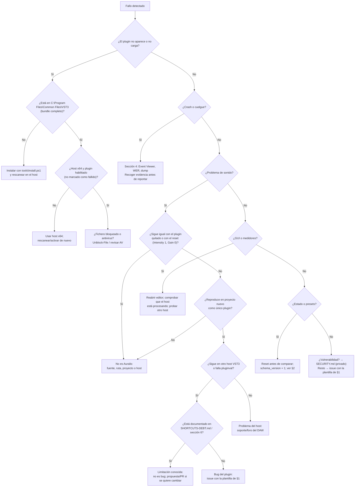

# TROUBLESHOOTING.md — Soporte y auto-diagnóstico

Manual para **quien da soporte** (mantenedor/contribuidor) y para el **usuario avanzado** que quiere diagnosticar antes de abrir un issue.

Ámbito: Auralis **v0.2.0**, VST3, **Windows 10/11 x64**, host prioritario FL Studio y otros hosts VST3 x64. Si buscas uso del plugin, empieza por [USER-GUIDE.md](USER-GUIDE.md); si vas a compilar o publicar, por [BUILD-TEST-RELEASE.md](BUILD-TEST-RELEASE.md).

> Este documento describe el comportamiento real del código actual. Las causas listadas están ancladas a archivos concretos (`Source/plugin/*`, `modules/dsp/*`, `Source/presets/PresetManager.cpp`, `Source/ui/SpectrumView.cpp`) y a `.github/workflows/ci.yml` / `tools/install.ps1`.

---

## 1. Cómo reportar un bug correctamente

**Primero decide el canal:**

| Caso | Canal |
|---|---|
| Fallo funcional, crash reproducible, duda de integración con un host | **Issue público** en el repositorio (plantilla de abajo) |
| Vulnerabilidad, fuga de información, algo explotable | **Privado**: [SECURITY.md](../SECURITY.md) (GitHub Security Advisory) — **nunca** un issue público con detalles |
| Cambio de código, nueva feature, PR | [CONTRIBUTING.md](../CONTRIBUTING.md): issue primero, luego PR con tests ejecutados |

**Datos obligatorios** (sin ellos el reporte se devuelve):

- Versión del plugin. La GUI **no muestra la versión**: usa `CMakeLists.txt` (`project(Auralis VERSION 0.2.0)`), el commit (`git rev-parse --short HEAD`) y, si lo instalaste, la fecha/hash del `.vst3` (§3.4).
- DAW y versión (p. ej. FL Studio 21.2, 64-bit).
- Versión de Windows.
- Sample rate y buffer size del proyecto (p. ej. 48 kHz / 512).
- Pista mono o estéreo.
- Pasos numerados y mínimos para reproducir.
- Esperado vs. real (una frase cada uno).
- Evidencia: captura, grabación, salida de `ctest`/`pluginval`, y en crashes el evento de Event Viewer / informe WER (§4).

**Plantilla para copiar:**

```markdown
### Entorno
- Plugin: Auralis 0.2.0 (commit <hash>); instalado en <ruta> el <fecha> (SHA256 <hash>)
- DAW: FL Studio <versión> x64
- Windows: <10/11, build> (winver)
- Sample rate / buffer: <Hz / samples>
- Pista: mono / estéreo
- Otros plugins en la cadena: <sí/no, cuáles>

### Pasos
1.
2.
3.

### Esperado

### Real

### Reproducibilidad
- Siempre / a veces / una vez
- Ocurre con el plugin recién reseteado (Reset, Intensity=1, Gain=0 dB): sí/no
- Ocurre en un proyecto nuevo con solo Auralis: sí/no
- Ocurre en otro host VST3: sí/no

### Evidencia
<capturas, grabaciones, consola de pluginval, evento WER>
```

**Recoge el entorno de golpe** (PowerShell, desde la raíz del repo):

```powershell
git rev-parse --short HEAD
winver
(Get-Item 'build\Auralis_artefacts\Release\VST3\Auralis.vst3\Contents\x86_64-win\Auralis.vst3').VersionInfo |
    Select-Object FileVersion, ProductVersion
```

**Qué NO hacer:** no adjuntes públicamente volcados (dumps) ni el proyecto/sesión sin permiso de quien lo creó (§4); no incluyas rutas personales, nombres de usuario ni material de terceros. En un issue público, eso es información que no puede retirarse del historial.

---

## 2. Diagnóstico rápido

| Síntoma | Causa probable | Comprobación | Solución |
|---|---|---|---|
| No aparece en FL Studio | El build no se instala solo (`COPY_PLUGIN_AFTER_BUILD FALSE` en `CMakeLists.txt`) y no está en la carpeta que escanea el host | ¿Existe `C:\Program Files\Common Files\VST3\Auralis.vst3\Contents\x86_64-win\Auralis.vst3`? | `powershell -File tools\install.ps1` y rescan en el gestor de plugins del host |
| No aparece (2) | Copia incompleta del bundle o ruta distinta | Falta `Contents\x86_64-win`; solo copiaste el `.vst3` interno | Copiar el bundle `.vst3` completo o reinstalar con el script |
| No aparece (3) | Host de 32 bits, o el host marcó el plugin como fallido tras un crash / scan fallido | Arquitectura del host (debe ser x64) y estado del plugin en su gestor | Usar host x64; en FL Studio, rescanear/”rescan previously failed plugins” y reactivarlo si está deshabilitado |
| No aparece (4) | Fichero bloqueado por Windows (descargado de internet) o en cuarentena del antivirus | Mira los atributos del fichero instalado (`Get-Item`); revisa el antivirus | `Unblock-File "$env:COMMONPROGRAMFILES\VST3\Auralis.vst3\Contents\x86_64-win\Auralis.vst3"`; añade excepción si el AV lo puso en cuarentena |
| No suena o suena igual que sin plugin | Bypass activo, **Intensity a 0**, Gain muy bajo, o el audio no llega a la pista | Reset + Intensity 1 + Gain 0 dB y comparar quitando el plugin | Subir Gain/Intensity; desactivar bypass; revisar ruta y mute del mixer |
| Bypass no cambia nada / no bypassa todo | `bypass` solo desactiva la **etapa de master gain** (`GainProcessor`); EQ, Bass, Clarity, compresor, reverb, estéreo y limitador siguen activos | A valores por defecto la cadena entera ya es transparente | Comportamiento actual (ver §6). Para comparar en serio, quita el plugin de la cadena |
| Distorsiona o “bombea” | Nivel de entrada alto → limitador y clamp del techo trabajando; compresor; saturación de graves; el plugin está dos veces en la cadena | Medidores In/Out y “Corr”; elimina la segunda instancia | Bajar Gain, subir Threshold/ceiling del limitador, bajar Bass Saturation; una sola instancia |
| El estéreo suena raro en mono | Width > 1, Side Gain o Ambience Width crean contenido lateral que se cancela al sumar a mono | Mira “Corr”: valores negativos indican riesgo de cancelación | Bajar Width/Side; si el proyecto se escucha en mono, mantén Corr ≥ 0 |
| CPU alta o glitches | Buffer pequeño + sample rate alto; limitador con escaneo O(N·L) por muestra; analizadores FFT cada 2 bloques; otras cadenas del host | Sube el buffer temporalmente a 512/1024, prueba a 48 kHz, deja solo Auralis | Buffer ≥ 256, cerrar la GUI (deja de repintar), revisar [SHORTCUTS-DEBT.md](SHORTCUTS-DEBT.md) |
| La GUI no abre o no refresca | El host no está procesando audio (sin `processBlock` los medidores se congelan) o problema del wrapper del host; el editor solo repinta el espectro a 30 Hz | ¿Suena el audio? ¿Se mueven In/Out dB? Reabre el editor | Reabrir la ventana; desactivar la suspensión de procesado del host; probar en otro DAW |
| El espectro no se mueve, o las primeras barras siempre están a 0 | Sin procesado no hay datos; y las bandas por debajo de la resolución del FFT (1024 muestras) leen 0 **por diseño** (`SpectrumAnalyzer.cpp`) | ¿Se mueven las líneas “In/Out dB”? ¿Solo están muertas las primeras bandas? | Las primeras bandas muertas son esperadas; si todo está congelado, ver la fila de GUI |
| Muevo un parámetro y no se oye | Intensity escala ganancias/amounts/width; con Ratio = 1 el compresor es transparente; parámetros de un módulo con Mix/Amount a 0 son inaudibles | Intensity = 1; sube el control del efecto **y** su Amount/Mix; con compresor, sube Ratio por encima de 1 | Subir Intensity o el control de mezcla del módulo |
| Los cambios no se guardan al reabrir el proyecto | El host no guardó el estado del plugin, o se confundió un preset del host con guardar el proyecto | Guardar, cerrar y reabrir; probar en un proyecto nuevo | Guardar el proyecto del host; el estado del plugin (incluidos A/B) viaja en él |
| Presets que no aplican o suenan distintos | `schema_version` distinto → `fromJson` devuelve `false` y la GUI **no avisa**; los presets de fábrica solo fijan los parámetros que listan | Abre el `.auralis` en un editor de texto: `schema_version` debe ser `1` y los valores numéricos | Regenerar el preset con esta versión; hacer Reset antes de comparar dos presets |
| El plugin no carga en una pista multicanal | Solo se aceptan layouts **mono o estéreo** con entrada = salida (`isBusesLayoutSupported`) | Estado del plugin en el host; prueba en pista mono/estéreo | Usar pista mono o estéreo (limitación de v0.2.0) |
| Fase o doblaje al usar el plugin en paralelo | 5 ms de lookahead del limitador; si el host no compensa la latencia, dry + wet se desalinean | Mezclar la pista con y sin plugin y escuchar el comb filtering | Compensar la latencia en el host o evitar paralelo sin compensación |

---

## 3. Diagnóstico por área técnica

### 3.1 Build

```powershell
git submodule update --init --recursive   # JUCE es un submódulo fijado; sin él cmake falla
git submodule status                      # debe mostrar el commit de JUCE (no vacío ni "-")
cmake --preset msvc
cmake --build --preset release
```

- `cmake --preset msvc` requiere **Visual Studio 2022** con la carga “Desktop development with C++” (generador `Visual Studio 17 2022`, x64).
- Si el configure falla tras cambiar de rama o de versión de CMake, haz un rebuild limpio:

```powershell
Remove-Item -Recurse -Force build
cmake --preset msvc
cmake --build --preset release
```

- Advertencias nuevas cuentan como fallo de calidad (AGENTS.md). No las “arregles” silenciándolas.

### 3.2 Tests

```powershell
cmake --build --preset release
ctest --test-dir build -C Release --output-on-failure
```

El preset `msvc` genera Debug y Release a la vez, por eso `-C Release` es obligatorio. En CI (Ninja, un solo config) basta `ctest --test-dir build-ci --output-on-failure`. Los tests unitarios cubren DSP y analizador (`tests/unit/`), no GUI ni host.

### 3.3 pluginval a estrictitud 8

Es el validador externo que exige el *definition of done* (AGENTS.md §5) y el que corre en CI. Comando exacto (desde la raíz, con la build Release recién hecha):

```powershell
pluginval --strictness-level 8 --validate build/Auralis_artefacts/Release/VST3/Auralis.vst3
```

pluginval no se distribuye con el repo; CI descarga la v1.0.4:

```powershell
Invoke-WebRequest -Uri https://github.com/Tracktion/pluginval/releases/download/v1.0.4/pluginval_Windows.zip -OutFile pluginval_Windows.zip
Expand-Archive -Path pluginval_Windows.zip -DestinationPath pluginval
./pluginval/pluginval.exe --strictness-level 8 --validate build/Auralis_artefacts/Release/VST3/Auralis.vst3
```

Valida **el artefacto exacto** que vas a instalar. Si validas un `build/` viejo o un Debug, el resultado no sirve: vuelve a compilar y compara hashes (§3.4). Interpretación de fallos en §5.

### 3.4 Verificación de la instalación

Instalación (copia el bundle a la carpeta de sistema que escanea FL Studio):

```powershell
powershell -File tools\install.ps1
# una build concreta:
powershell -File tools\install.ps1 -Vst3Path "build\Auralis_artefacts\Release\VST3\Auralis.vst3"
```

Escribir en `C:\Program Files\Common Files\VST3` puede requerir PowerShell **como administrador** (“acceso denegado” = falta elevación).

Comprueba versión, fecha y hash del instalado frente al que compilaste:

```powershell
$installed = "$env:COMMONPROGRAMFILES\VST3\Auralis.vst3\Contents\x86_64-win\Auralis.vst3"
$built     = "build\Auralis_artefacts\Release\VST3\Auralis.vst3\Contents\x86_64-win\Auralis.vst3"

Get-Item $installed | Select-Object FullName, LastWriteTime, Length
(Get-Item $installed).VersionInfo | Select-Object FileVersion, ProductVersion
Get-FileHash $installed -Algorithm SHA256
Get-FileHash $built     -Algorithm SHA256   # los dos hashes deben coincidir
```

Si el hash no coincide, el host está cargando una versión vieja: reinstala con `install.ps1` y rescanear.

### 3.5 ¿Es del plugin o del host?

En este orden (cada paso aísla una capa):

1. **Quita el plugin** de la cadena y compara la misma fuente. Si el problema sigue sin Auralis, es del host, de la fuente o de otro plugin.
2. **Reset + Intensity 1 + Gain 0 dB.** A valores por defecto la cadena es transparente en la práctica: solo actúan el clamp del limitador por encima de 0 dBFS y su latencia de 5 ms (declarada al host). Si el problema desaparece con este reset, era un parámetro, no el motor.
3. **Proyecto nuevo** con Auralis como único plugin en una pista mono o estéreo. Si no se reproduce, era del proyecto (ruta, automatización, estado guardado, otros plugins).
4. **Otro host VST3.** Si allí funciona y en tu host no, es integración/del host (wrapper, escaneo, ventana, compensación de latencia).
5. **`pluginval` a estrictitud 8** sobre el artefacto instalado. Valida parámetros, estado y layouts sin host. Si pasa y el problema persiste en un solo DAW, apunta al host; si falla, el problema es del plugin (§5).
6. Confirma que el host **procesa** la pista (sin mute, ruteada a master) y que la señal llega con nivel suficiente para el limitador.

---

## 4. Triaje de crash en Windows

El plugin no genera telemetría ni logs (no hay red ni E/S en la ruta de audio, ver [SECURITY.md](../SECURITY.md)); toda la evidencia sale del sistema y del host. Cuando un plugin VST3 crashea, **crashea el proceso del DAW** (p. ej. `FL64.exe`), no un proceso aparte.

### 4.1 Event Viewer (visor de eventos)

```powershell
Get-WinEvent -FilterHashtable @{ LogName='Application'; Id=1000,1001 } -MaxEvents 10 |
    Select-Object TimeCreated, Id, ProviderName, Message | Format-List
```

- **Id 1000** = “Application Error”: anota el módulo que falla y el offset (¿`Auralis.vst3`? ¿`FL64.exe`? ¿un DLL de terceros?).
- **Id 1001** = “Windows Error Reporting”: incluye el `ReportId` y el `BucketId`, imprescindibles para buscar el crash.

### 4.2 Informes WER

```powershell
Get-ChildItem "$env:LOCALAPPDATA\Microsoft\Windows\WER\ReportArchive",
              "$env:ProgramData\Microsoft\Windows\WER\ReportArchive" -Recurse -Filter *.wer -ErrorAction SilentlyContinue |
    Sort-Object LastWriteTime -Descending | Select-Object -First 5 FullName, LastWriteTime
```

En el `.wer` busca `AppName`, `FaultingModuleName`, `ExceptionCode`, `Sig[...]` y la ruta de un `.dmp` si existe.

### 4.3 Obtener un dump

Método simple (no requiere instalar nada): **Task Manager → pestaña Details → clic derecho en el proceso del DAW → “Create dump file”**. Hazlo justo después de reproducir el crash, antes de cerrar el host.

Método avanzado (captura automática de dumps de ese host): activar *Local Dumps* en el registro **solo si el usuario acepta** y borrarlo después:

```powershell
reg add "HKLM\SOFTWARE\Microsoft\Windows\Windows Error Reporting\LocalDumps\FL64.exe" /v DumpFolder /t REG_EXPAND_SZ /d "$env:LOCALAPPDATA\AuralisCrashDumps" /f
reg add "HKLM\SOFTWARE\Microsoft\Windows\Windows Error Reporting\LocalDumps\FL64.exe" /v DumpType /t REG_DWORD /d 2 /f
# ... reproducir el crash ...
reg delete "HKLM\SOFTWARE\Microsoft\Windows\Windows Error Reporting\LocalDumps\FL64.exe" /f
```

El dump pesa cientos de MB o GB y puede contener **audio de la sesión, rutas y datos del proyecto**: trátalo como material privado del usuario.

### 4.4 Qué recoger antes de reportar

- Momento del crash: al **escanear**, al **cargar** el plugin, al **abrir/cerrar el editor**, o durante el **audio** (marca uno).
- Proyecto mínimo que reproduce + si pasa también en un proyecto nuevo con un solo Auralis.
- Entrada de Event Viewer (1000/1001) y `ReportId`.
- Dump, si el usuario acepta compartirlo. Si no, basta el `FaultingModuleName` y el `ExceptionCode`.
- Versión/commit del plugin, versión del host, Windows.

### 4.5 Qué NO hacer

- **No** subas el proyecto, el dump ni capturas con rutas personales a un issue público sin permiso explícito de su dueño.
- **No** borres los informes WER “para limpiar” antes de que soporte los pida.
- **No** reportes un crash como issue público si sospechas que es explotable (buffer overflow, uso de memoria tras liberar): canal privado de [SECURITY.md](../SECURITY.md).

---

## 5. Interpretación de fallos de pluginval a estrictitud 8

A estrictitud 8 pluginval es deliberadamente agresivo: automatiza parámetros, guarda/restaura estado, prueba layouts de bus, abre y cierra el editor y llama desde varios hilos. Un fallo aquí **bloquea el PR** (AGENTS.md §5). Lee **el primer fallo** de la salida, no el último efecto dominó.

| Tipo de fallo | Qué suele indicar en este código | Dónde mirar |
|---|---|---|
| El plugin no carga (no es “test failed” sino load fail) | Artefacto incompleto o mal formado, ruta incorrecta, build Debug | Rehacer build Release y validar exactamente `build/Auralis_artefacts/Release/VST3/Auralis.vst3` |
| Parámetros no automatizables o que no responden | ID de parámetro cambiado/duplicado (los IDs son API estable), versión de `ParameterID`, valor que no llega al DSP | `Source/plugin/ParameterLayout.cpp`; `cacheParams`/`pushParameters` en `PluginProcessor.cpp` |
| Fallos de estado (“state is not valid”, valores que no vuelven tras restore) | `getStateInformation`/`setStateInformation`: árbol del A/B (`Slots`), atributo `schema_version`, XML corrupto | `PluginProcessor.cpp` (§ estado y A/B); `PresetManager` para la parte de presets |
| Layouts de bus no soportados / rechazo que crashea | El plugin solo declara mono y estéreo, con entrada = salida | `isBusesLayoutSupported` en `PluginProcessor.cpp` |
| Fallos de hilos (“call from wrong thread”, crash bajo carga) | Procesado y parámetros desde hilos distintos; reglas RT violadas (locks, asignaciones) | `AGENTS.md` §3, [RUNTIME-FLOWS.md](RUNTIME-FLOWS.md), módulos DSP implicados |
| Crash/leak al abrir o cerrar el editor | Ciclo de vida del editor: attachments, timer de 30 Hz, `FileChooser` | `Source/plugin/PluginEditor.cpp`, `Source/ui/SpectrumView.cpp` |
| Resultados no repetibles / NaN o inf en la salida | Estado no reseteado entre pases, denormales, oscilación de un filtro o del limitador | Tests de `tests/unit/`, módulo DSP señalado por la traza |

Regla práctica: si el fallo menciona **parámetros o estado**, es del adaptador (`Source/plugin`); si menciona **audio, NaN o rendimiento**, es de un módulo DSP; si menciona **editor**, es de `Source/ui`.

---

## 6. Limitaciones conocidas de la v0.2.0

Lista detallada y con plan de mejora: [SHORTCUTS-DEBT.md](SHORTCUTS-DEBT.md). Lo que hoy es comportamiento esperado (y por tanto **no es un bug**):

- **El bypass solo afecta al master gain.** `bypass` se aplica a `GainProcessor` (`pushParameters` → `setBypass`), así que el resto de la cadena sigue procesando. Además, `getBypassParameter()` expone ese mismo parámetro al host: el bypass del DAW tampoco apaga toda la cadena.
- **Intensity = 0 no es “plugin apagado”.** Escala ganancias/amounts/width de la mayoría de módulos, pero no las frecuencias, los tiempos, ni el balance estéreo, ni el limitador. Master Gain sigue aplicando.
- **EQ sin suavizado en frecuencia y Q de shelf/peaking:** al automatizar pueden oírse saltos (“zipper”). Marca `shortcut:` en `modules/dsp/equalizer/EqualizerProcessor.h`.
- **Bass Sub HP de un solo biquad (12 dB/oct):** protección de subs más suave de lo que sugiere un HP típico. Marca `shortcut:` en `modules/dsp/bass/BassEnhancerProcessor.h`.
- **Límite de 2 canales en varios módulos:** el limitador y el excitador procesan como máximo 2 canales; canales extra pasan sin procesar. Los buses solo aceptan mono o estéreo, con entrada = salida.
- **Coste del limitador:** ventana de picos O(N·L) por muestra con L = 5 ms de lookahead; con muestras altas y buffers pequeños se nota. Marca `shortcut:` en `modules/dsp/limiter/LimiterProcessor.cpp`.
- **Presets con `schema_version` estricto (hoy `1`):** un preset de otra versión se rechaza y la GUI no muestra error (`loadUserPreset` devuelve `false` y el botón Load lo ignora). Los presets de fábrica solo fijan los parámetros que listan; no son un “reset total”.
- **Alcance de producto:** solo VST3 y Windows x64; cadena DSP fija sin reordenar; sin sidechain, sin presets de terceros ([PRODUCT.md](PRODUCT.md)).
- **La GUI no muestra la versión del plugin** ni un aviso de que un preset no se pudo cargar.

---

## 7. Escalado: bug, limitación, host o seguridad



Resumen del reparto:

| Situación | Destino |
|---|---|
| Reproducible con reset, proyecto nuevo y/u otro host; pluginval falla | Bug del plugin → issue público |
| Reproducible solo en un host, pluginval pasa | Integración/host → soporte del DAW (y avisar al repo si afecta a VST3 en general) |
| Está en §6 o en [SHORTCUTS-DEBT.md](SHORTCUTS-DEBT.md) | Limitación conocida → propuesta/PR, no issue de bug |
| Duda de uso (parámetros, intensidad, presets) | [USER-GUIDE.md](USER-GUIDE.md) |
| Build, tests, pluginval, release | [BUILD-TEST-RELEASE.md](BUILD-TEST-RELEASE.md) |
| Explotable o fuga de información | [SECURITY.md](../SECURITY.md) (privado) |

---

## 8. Glosario para soporte

| Término | Definición breve |
|---|---|
| **Sample rate** | Muestras por segundo del proyecto (44.1/48/88.2/96 kHz). Cambia el coste del DSP y la resolución del espectro. |
| **Buffer / block size** | Muestras por bloque que el host entrega a `processBlock`. Más pequeño = menos latencia y más carga de CPU. |
| **VST3 bundle** | Carpeta `Auralis.vst3` con `Contents\x86_64-win\Auralis.vst3` dentro. Si se copia incompleta, el host no la ve. |
| **Escaneo / lista de fallidos** | El host indexa los plugins instalados; si uno crashea al escanear, puede marcarlo como fallido y ocultarlo hasta reactivarlo. |
| **pluginval** | Validador externo de plugins VST3 (Tracktion). Simula automatización, estado, layouts, editor e hilos sin DAW. |
| **Estrictitud (strictness)** | Nivel de exigencia de pluginval. El proyecto exige el **8**, el más alto. |
| **WER** | Windows Error Reporting: informes de crash del sistema (`Id 1001` en Event Viewer). |
| **Dump / minidump** | Volcado de memoria de un proceso en el momento del crash. Puede contener audio y datos de la sesión: es privado. |
| **Latencia / lookahead** | Retardo que introduce el limitador (5 ms). El plugin lo declara al host, que debe compensarlo. |
| **Passthrough / transparente** | La salida iguala a la entrada. A valores por defecto Auralis es transparente salvo clamp > 0 dBFS y latencia. |
| **schema_version** | Versión del formato de preset `.auralis` (hoy `1`). Si no coincide, el preset se rechaza. |
| **APVTS** | Árbol de parámetros de JUCE (`AudioProcessorValueTreeState`); es lo que se guarda en el estado del host (más los slots A/B). |

---

Documentos relacionados: [USER-GUIDE.md](USER-GUIDE.md) · [BUILD-TEST-RELEASE.md](BUILD-TEST-RELEASE.md) · [SHORTCUTS-DEBT.md](SHORTCUTS-DEBT.md) · [RUNTIME-FLOWS.md](RUNTIME-FLOWS.md) · [ARCHITECTURE.md](ARCHITECTURE.md) · [PRODUCT.md](PRODUCT.md) · [CONTRIBUTING.md](../CONTRIBUTING.md) · [SECURITY.md](../SECURITY.md)
